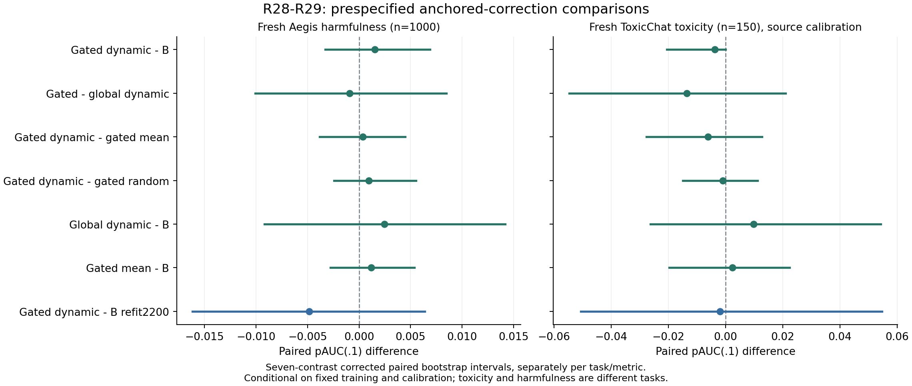

# R28—R29：少量融合与边界局部融合验证

**结论：两个方向都未确认带来可靠增益，继续保留末位参照。** 局部门控确实做到远离训练侧估计边界时不改末位分数，但没有把这一性质转化为更好的检测表现。全局动态融合选中了权重1，退回原联合头。增加600条标签的纯末位重训练在新Aegis上点值更高，但跨来源没有一致优势，不能据此宣布数据量方案已经胜出。

## 从R27推导出的两个方向

R27提示：用户摘要有信息，但直接加入后，召回和误报一起下降，低误报收益又依赖测试样本。因此提出两个假设：一是摘要影响可能太大，先对齐分数尺度，再少量加入；二是摘要可能只在报警边界附近有帮助，远处沿用末位。

**R28全局融合：** 固定R27第一个训练种子的末位头B和三个既有联合头，使用原dev600作为明确的元训练集，在每个训练折的正常样本上对齐分数均值和标准差，再选择融合权重。E是原“末位＋摘要”联合头的分数，不是单独用户专家。均值／动态／同维双随机每类各9参数。

**R29局部融合：** 在同样的分数对齐基础上，只有B靠近元训练正常分数95%分位时才加入E，使用紧支撑三角门；门外原分数严格等于B。每类也9参数，比较融合量和门宽。这是报警边界，不是认知不确定性，保持分数也不等于证明节省推理成本。

**额外标签对照B_refit：** 融合使用了基础1600条之外的600条标签，因此额外训练一个同样使用1600＋600标签的完整末位岭回归，给9组λ和同样10折。避免将新增监督预算的价值误算成加工／门控收益。

## 如何保证比较清楚

本轮固定R27 draw0，不按旧测试选种子，也不引入五模型集成。元训练600与基础头1600无交叉，校准和测试都不进训练。55候选×10元CV评分条件，加9×10折B_refit拟合，共640项CV指标；最终11头提交冻结后才评分。

固定C始终同一1000条。本轮B是draw0，C上AUROC0.914152；R27概要表是五头指标均值0.915930，二者口径不同，不能把差当作换数据或模型退步。K与R27新确认J也不同，不跨批计算增量。

新Aegis K为正常／危险各500，仍是同源留出。新Toxic L仅人类标注且此前未使用的正常／毒性各75，是独立毒性辅助任务，不能和有害请求检测混算。全部新输入排除18722个历史ID及规范化精确／声明的近重复。L中正常原train27／test48，毒性原train70／test5，原分区组成并不平衡，样本小，不能称官方测试或广泛跨领域证明。原始文件均与既有revision／SHA锁定一致。

## 训练侧实际选了什么

- 全局均值和随机：融合权重0.5；全局动态：权重1，与原动态联合头只是正向仿射变换，排序和独立校准后的报警相同，没有形成新的动态方案。
- 局部均值：权重0.5、门宽2个正常标准差；局部动态和随机：权重1、门宽0.5个标准差。
- 元CV原始最佳是局部动态，pAUC0.812623；B为0.809821，差0.002801，小于预定一SE容差0.012260，最终预选仍为B。一SE为重叠折启发式，不是正式区间。
- 等标签B_refit仍选λ1。没有按新测试最高点挑参数或种子。

## 新Aegis K：没有确认门控补强末位

|方案|AUROC|低误报pAUC|召回|正常误报|
|---|---:|---:|---:|---:|
|原末位B，1600训练|0.923892|0.797053|68.2%|5.0%|
|R28全局均值，权重0.5|0.924948|0.798547|66.4%|4.8%|
|R28全局动态，权重1|0.925028|0.799495|65.8%|4.8%|
|R29局部动态|0.924184|0.798589|66.6%|4.8%|
|R29局部均值|0.924300|0.798232|66.4%|4.8%|
|R29局部随机|0.924004|0.797642|68.0%|5.2%|
|等标签末位B_refit，2200训练|0.927176|0.803432|70.2%|6.2%|

局部动态只改动15.9%的分数，84.1%保持原值，但AUROC对B仅+0.000292，七比较修正区间[−0.000656,+0.001311]；pAUC仅+0.001537，区间[−0.003284,+0.006893]。对全局动态、局部均值、局部随机和等标签B_refit的增量也都未确认。

局部动态比B少抓8/500条危险输入，少误报1/500条正常输入。召回差−1.6个百分点，修正区间[−3.4,0.0]，误报差−0.2个百分点，区间[−1.2,+0.8]。不能将更少报警说成更好的低误报检测，更不能将分数保持率当作准确率提升。

全局动态相对B的pAUC差+0.002442，修正区间[−0.009188,+0.014193]。等标签末位点值较高，但B_refit−B不是预设七项主比较，本报告仅作描述；局部动态−B_refit是预设比较，pAUC差−0.004842，区间[−0.016193,+0.006364]，未确认差异。额外标签对照说明不能把收益轻易归因于门控。

## 新Toxic L：没有出现一致跨来源收益

采用原400条同来源正常样本校准，B的AUROC0.892444／pAUC0.674386，召回49.33%、误报6.67%；全局动态为0.894222／0.684211，52.00%／6.67%；局部动态为0.891733／0.670643，49.33%／6.67%。局部动态改动16.0%分数，召回和误报均未改善。

全局动态−B的pAUC差+0.009825，修正区间[−0.026336,+0.054269]；局部动态−B为−0.003743，区间[−0.020585,0]，没有增益证据。B_refit为0.889600／0.672515，召回53.33%、误报6.67%，整体排序点值反而低于B；不能据此宣称多600条训练已带来稳定跨来源提升。global和source阈值两种政策的完整表保留在下方，不混成平均分。

## 对下一步的影响

这次排除了“只要少量融合或只改边界附近，就能稳定挖出用户摘要增量”的乐观解释。并没有证明所有门控无效，只说明当前固定分数、元训练量和有限网格没找到可靠收益。可能用户摘要与末位高度重叠，也可能报警附近的那部分改动缺乏稳定方向；当前实验不能区分这两种原因。

暂不继续扩展同一分数池的门控、PSO或交互参数。更值得下一步预注册的是：固定末位表示与岭回归，做训练样本量／来源多样性曲线，检查增量是否来自更多有效监督，并保留均值／动态作为对照。B_refit点值只是线索，下一步尚未执行。新K/L评分后成为历史数据，不再作为未见验证。

## 统计与复核

七项预设配对比较按每任务、每指标分别Bonferroni校正，5000次分层bootstrap共享相同重采样ID。主终点新Aegis pAUC，AUROC、召回和误报分别解释；没有宣称跨所有指标／来源同时控制错误率。所有新Aegis主比较的修正区间均包含零。区间条件于固定基础／元／重训练和校准，不包含训练总体不确定性。本轮只验证固定draw0，未重复R27的五训练；元训练600有历史观察，不能冒充新数据。

新增特征提取201.11秒，元参数和B_refit训练16.17秒；仅550项是元评分条件，另90折为实际末位拟合。32旧训练探针的末位与全部五摘要差均0，1750新增输入公共前缀差0；四冻结头2200条旧分数最大差1.35e−14。未训练底座。最终模型的预测仍依赖封存的私有基础表示；没有声称部署时延改善。

评分前冻结提交`8e36336bb46661a6ff8ae4d7dc2c708482859a52`；freeze SHA256为`650447094b00921b4991b4c7d9c9c48d2964ed27df82dcbc5d5da037c0134f60`。服务器与本地完整重放640项CV指标、66项测试条件和5000次bootstrap，全部通过；服务器另核对真实私有缓存。双方evaluation SHA256为`8b70b2efe3c262642fd44568c3a20b361551ebfe8793511d3b2120241f6ed815`。

复核：`python configs/anchored/verify.py --bootstrap`，服务器加`--actual`。以下保留全部11头、六测试条件和候选元CV结果，包含不利结果。

## 完整冻结结果表

Models and meta parameters frozen before scoring. New tasks reported separately.

Meta selection: {'winners': {'global_mean': 'global_mean_5', 'global_dynamic': 'global_dynamic_8', 'global_random': 'global_random_5', 'gated_mean': 'gated_mean_5', 'gated_dynamic': 'gated_dynamic_6', 'gated_random': 'gated_random_6'}, 'raw_best': 'gated_dynamic_6', 'selected': 'B', 'heuristic_se': 0.012259969110989515, 'scope': 'meta_train CV only; excludes random; B preferred within heuristic oneSE', 'selected_head': 'B'}
Fresh counts per class: {'aegis': 500, 'toxic': 75}

## Train-side selected settings

|Head|Parameters|
|---|---|
|B|{'name': 'B', 'mode': 'raw', 'family': 'B', 'alpha': 0.0}|
|joint_mean|{'mode': 'raw', 'family': 'mean'}|
|joint_dynamic|{'mode': 'raw', 'family': 'dynamic'}|
|joint_random|{'mode': 'raw', 'family': 'random'}|
|global_mean|{'name': 'global_mean_5', 'mode': 'global', 'family': 'mean', 'alpha': 0.5}|
|global_dynamic|{'name': 'global_dynamic_8', 'mode': 'global', 'family': 'dynamic', 'alpha': 1.0}|
|global_random|{'name': 'global_random_5', 'mode': 'global', 'family': 'random', 'alpha': 0.5}|
|gated_mean|{'name': 'gated_mean_5', 'mode': 'gated', 'family': 'mean', 'alpha': 0.5, 'width': 2.0}|
|gated_dynamic|{'name': 'gated_dynamic_6', 'mode': 'gated', 'family': 'dynamic', 'alpha': 1.0, 'width': 0.5}|
|gated_random|{'name': 'gated_random_6', 'mode': 'gated', 'family': 'random', 'alpha': 1.0, 'width': 0.5}|
|B_refit|{'method': 'ridge', 'value': 1.0}|

## test_aegis_holdout:global

|Head|AUROC|pAUC(.1)|Recall|FPR|Changed fraction vs B|
|---|---:|---:|---:|---:|---:|
|B|0.914152|0.797116|63.6%|4.4%|0.0%|
|joint_mean|0.916252|0.804674|64.2%|4.4%|100.0%|
|joint_dynamic|0.914120|0.803895|64.0%|4.8%|100.0%|
|joint_random|0.916380|0.806400|66.0%|4.8%|100.0%|
|global_mean|0.915524|0.801958|63.6%|4.2%|100.0%|
|global_dynamic|0.914120|0.803895|64.0%|4.8%|100.0%|
|global_random|0.915596|0.802358|64.6%|4.8%|100.0%|
|gated_mean|0.915128|0.801389|63.6%|4.2%|69.8%|
|gated_dynamic|0.914820|0.800632|62.8%|4.6%|18.4%|
|gated_random|0.915092|0.802063|65.4%|5.0%|18.4%|
|B_refit|0.916860|0.800421|66.6%|5.0%|100.0%|

|Contrast|Delta pAUC|Seven-contrast corrected interval|Delta AUROC|Corrected interval|
|---|---:|---|---:|---|
|gated_dynamic_vs_B|+0.003516|[-0.002743, +0.011035]|+0.000668|[-0.000522, +0.002133]|
|gated_vs_global_dynamic|-0.003263|[-0.009856, +0.002767]|+0.000700|[-0.002277, +0.003702]|
|gated_dynamic_vs_mean|-0.000758|[-0.004957, +0.003750]|-0.000308|[-0.001253, +0.000689]|
|gated_dynamic_vs_random|-0.001432|[-0.006908, +0.003420]|-0.000272|[-0.001309, +0.000661]|
|global_dynamic_vs_B|+0.006779|[-0.003287, +0.017768]|-0.000032|[-0.003496, +0.003524]|
|gated_mean_vs_B|+0.004274|[-0.000343, +0.009270]|+0.000976|[-0.000080, +0.002168]|
|gated_dynamic_vs_B_refit|+0.000211|[-0.015630, +0.016602]|-0.002040|[-0.006690, +0.002651]|

## test_toxic_holdout:global

|Head|AUROC|pAUC(.1)|Recall|FPR|Changed fraction vs B|
|---|---:|---:|---:|---:|---:|
|B|0.886225|0.709605|19.0%|0.5%|0.0%|
|joint_mean|0.895250|0.728158|16.5%|0.5%|100.0%|
|joint_dynamic|0.891025|0.717763|18.0%|0.5%|100.0%|
|joint_random|0.895525|0.729474|19.0%|0.5%|100.0%|
|global_mean|0.892750|0.720000|17.0%|0.5%|100.0%|
|global_dynamic|0.891025|0.717763|18.0%|0.5%|100.0%|
|global_random|0.891950|0.720526|17.5%|0.5%|100.0%|
|gated_mean|0.888075|0.714868|17.5%|0.5%|65.5%|
|gated_dynamic|0.886300|0.710000|18.0%|0.5%|12.8%|
|gated_random|0.886500|0.711053|18.5%|0.5%|12.8%|
|B_refit|0.898775|0.731579|21.5%|0.5%|100.0%|

|Contrast|Delta pAUC|Seven-contrast corrected interval|Delta AUROC|Corrected interval|
|---|---:|---|---:|---|
|gated_dynamic_vs_B|+0.000395|[-0.004888, +0.007895]|+0.000075|[-0.000929, +0.001500]|
|gated_vs_global_dynamic|-0.007763|[-0.028440, +0.015658]|-0.004725|[-0.014565, +0.004804]|
|gated_dynamic_vs_mean|-0.004868|[-0.011974, +0.003684]|-0.001775|[-0.003911, +0.000029]|
|gated_dynamic_vs_random|-0.001053|[-0.005151, +0.000789]|-0.000200|[-0.000979, +0.000150]|
|global_dynamic_vs_B|+0.008158|[-0.017144, +0.031842]|+0.004800|[-0.005057, +0.014668]|
|gated_mean_vs_B|+0.005263|[-0.003158, +0.012368]|+0.001850|[+0.000075, +0.003950]|
|gated_dynamic_vs_B_refit|-0.021579|[-0.044098, +0.003026]|-0.012475|[-0.025661, +0.000022]|

## test_toxic_holdout:source

|Head|AUROC|pAUC(.1)|Recall|FPR|Changed fraction vs B|
|---|---:|---:|---:|---:|---:|
|B|0.886225|0.709605|42.0%|4.5%|0.0%|
|joint_mean|0.895250|0.728158|46.5%|5.0%|100.0%|
|joint_dynamic|0.891025|0.717763|46.0%|5.0%|100.0%|
|joint_random|0.895525|0.729474|46.0%|4.0%|100.0%|
|global_mean|0.892750|0.720000|45.0%|4.5%|100.0%|
|global_dynamic|0.891025|0.717763|46.0%|5.0%|100.0%|
|global_random|0.891950|0.720526|46.5%|4.5%|100.0%|
|gated_mean|0.888075|0.714868|41.5%|4.0%|65.5%|
|gated_dynamic|0.886300|0.710000|42.0%|4.5%|12.8%|
|gated_random|0.886500|0.711053|42.0%|4.5%|12.8%|
|B_refit|0.898775|0.731579|46.5%|4.0%|100.0%|

|Contrast|Delta pAUC|Seven-contrast corrected interval|Delta AUROC|Corrected interval|
|---|---:|---|---:|---|
|gated_dynamic_vs_B|+0.000395|[-0.004888, +0.007895]|+0.000075|[-0.000929, +0.001500]|
|gated_vs_global_dynamic|-0.007763|[-0.028440, +0.015658]|-0.004725|[-0.014565, +0.004804]|
|gated_dynamic_vs_mean|-0.004868|[-0.011974, +0.003684]|-0.001775|[-0.003911, +0.000029]|
|gated_dynamic_vs_random|-0.001053|[-0.005151, +0.000789]|-0.000200|[-0.000979, +0.000150]|
|global_dynamic_vs_B|+0.008158|[-0.017144, +0.031842]|+0.004800|[-0.005057, +0.014668]|
|gated_mean_vs_B|+0.005263|[-0.003158, +0.012368]|+0.001850|[+0.000075, +0.003950]|
|gated_dynamic_vs_B_refit|-0.021579|[-0.044098, +0.003026]|-0.012475|[-0.025661, +0.000022]|

## confirmation_aegis:global

|Head|AUROC|pAUC(.1)|Recall|FPR|Changed fraction vs B|
|---|---:|---:|---:|---:|---:|
|B|0.923892|0.797053|68.2%|5.0%|0.0%|
|joint_mean|0.925420|0.799642|66.0%|4.4%|100.0%|
|joint_dynamic|0.925028|0.799495|65.8%|4.8%|100.0%|
|joint_random|0.924768|0.798316|68.6%|5.6%|100.0%|
|global_mean|0.924948|0.798547|66.4%|4.8%|100.0%|
|global_dynamic|0.925028|0.799495|65.8%|4.8%|100.0%|
|global_random|0.924772|0.798421|67.2%|5.2%|100.0%|
|gated_mean|0.924300|0.798232|66.4%|4.8%|69.1%|
|gated_dynamic|0.924184|0.798589|66.6%|4.8%|15.9%|
|gated_random|0.924004|0.797642|68.0%|5.2%|15.9%|
|B_refit|0.927176|0.803432|70.2%|6.2%|100.0%|

|Contrast|Delta pAUC|Seven-contrast corrected interval|Delta AUROC|Corrected interval|
|---|---:|---|---:|---|
|gated_dynamic_vs_B|+0.001537|[-0.003284, +0.006893]|+0.000292|[-0.000656, +0.001311]|
|gated_vs_global_dynamic|-0.000905|[-0.010066, +0.008493]|-0.000844|[-0.003969, +0.002383]|
|gated_dynamic_vs_mean|+0.000358|[-0.003832, +0.004490]|-0.000116|[-0.001089, +0.000856]|
|gated_dynamic_vs_random|+0.000947|[-0.002427, +0.005519]|+0.000180|[-0.000501, +0.000978]|
|global_dynamic_vs_B|+0.002442|[-0.009188, +0.014193]|+0.001136|[-0.002438, +0.004558]|
|gated_mean_vs_B|+0.001179|[-0.002767, +0.005368]|+0.000408|[-0.000545, +0.001437]|
|gated_dynamic_vs_B_refit|-0.004842|[-0.016193, +0.006364]|-0.002992|[-0.007256, +0.001366]|

## confirmation_toxic:global

|Head|AUROC|pAUC(.1)|Recall|FPR|Changed fraction vs B|
|---|---:|---:|---:|---:|---:|
|B|0.892444|0.674386|24.0%|2.7%|0.0%|
|joint_mean|0.886756|0.682339|17.3%|2.7%|100.0%|
|joint_dynamic|0.894222|0.684211|17.3%|1.3%|100.0%|
|joint_random|0.891556|0.684211|21.3%|2.7%|100.0%|
|global_mean|0.891022|0.679064|22.7%|2.7%|100.0%|
|global_dynamic|0.894222|0.684211|17.3%|1.3%|100.0%|
|global_random|0.891733|0.680936|22.7%|2.7%|100.0%|
|gated_mean|0.893867|0.676725|22.7%|2.7%|67.3%|
|gated_dynamic|0.891733|0.670643|18.7%|1.3%|16.0%|
|gated_random|0.891911|0.671579|22.7%|2.7%|16.0%|
|B_refit|0.889600|0.672515|26.7%|2.7%|100.0%|

|Contrast|Delta pAUC|Seven-contrast corrected interval|Delta AUROC|Corrected interval|
|---|---:|---|---:|---|
|gated_dynamic_vs_B|-0.003743|[-0.020585, +0.000000]|-0.000711|[-0.003911, +0.000000]|
|gated_vs_global_dynamic|-0.013567|[-0.054737, +0.021053]|-0.002489|[-0.020648, +0.013867]|
|gated_dynamic_vs_mean|-0.006082|[-0.027671, +0.012700]|-0.002133|[-0.007289, +0.002337]|
|gated_dynamic_vs_random|-0.000936|[-0.014971, +0.011228]|-0.000178|[-0.002844, +0.002133]|
|global_dynamic_vs_B|+0.009825|[-0.026336, +0.054269]|+0.001778|[-0.014578, +0.020115]|
|gated_mean_vs_B|+0.002339|[-0.019718, +0.022456]|+0.001422|[-0.003556, +0.006222]|
|gated_dynamic_vs_B_refit|-0.001871|[-0.050595, +0.054737]|+0.002133|[-0.021689, +0.024559]|

## confirmation_toxic:source

|Head|AUROC|pAUC(.1)|Recall|FPR|Changed fraction vs B|
|---|---:|---:|---:|---:|---:|
|B|0.892444|0.674386|49.3%|6.7%|0.0%|
|joint_mean|0.886756|0.682339|53.3%|8.0%|100.0%|
|joint_dynamic|0.894222|0.684211|52.0%|6.7%|100.0%|
|joint_random|0.891556|0.684211|52.0%|6.7%|100.0%|
|global_mean|0.891022|0.679064|50.7%|6.7%|100.0%|
|global_dynamic|0.894222|0.684211|52.0%|6.7%|100.0%|
|global_random|0.891733|0.680936|52.0%|6.7%|100.0%|
|gated_mean|0.893867|0.676725|49.3%|6.7%|67.3%|
|gated_dynamic|0.891733|0.670643|49.3%|6.7%|16.0%|
|gated_random|0.891911|0.671579|49.3%|6.7%|16.0%|
|B_refit|0.889600|0.672515|53.3%|6.7%|100.0%|

|Contrast|Delta pAUC|Seven-contrast corrected interval|Delta AUROC|Corrected interval|
|---|---:|---|---:|---|
|gated_dynamic_vs_B|-0.003743|[-0.020585, +0.000000]|-0.000711|[-0.003911, +0.000000]|
|gated_vs_global_dynamic|-0.013567|[-0.054737, +0.021053]|-0.002489|[-0.020648, +0.013867]|
|gated_dynamic_vs_mean|-0.006082|[-0.027671, +0.012700]|-0.002133|[-0.007289, +0.002337]|
|gated_dynamic_vs_random|-0.000936|[-0.014971, +0.011228]|-0.000178|[-0.002844, +0.002133]|
|global_dynamic_vs_B|+0.009825|[-0.026336, +0.054269]|+0.001778|[-0.014578, +0.020115]|
|gated_mean_vs_B|+0.002339|[-0.019718, +0.022456]|+0.001422|[-0.003556, +0.006222]|
|gated_dynamic_vs_B_refit|-0.001871|[-0.050595, +0.054737]|+0.002133|[-0.021689, +0.024559]|

## All train-only candidate settings

|Candidate|Mean meta-CV pAUC|CV standard deviation|
|---|---:|---:|
|B|0.809821|0.039447|
|global_mean_0|0.809883|0.039782|
|global_mean_1|0.809587|0.040070|
|global_mean_2|0.809850|0.040155|
|global_mean_3|0.809852|0.040020|
|global_mean_4|0.810138|0.039269|
|global_mean_5|0.811115|0.040707|
|global_mean_6|0.810011|0.038548|
|global_mean_7|0.810306|0.039001|
|global_mean_8|0.808567|0.039833|
|global_dynamic_0|0.809751|0.039926|
|global_dynamic_1|0.810021|0.039982|
|global_dynamic_2|0.810579|0.039798|
|global_dynamic_3|0.810439|0.038902|
|global_dynamic_4|0.811015|0.038764|
|global_dynamic_5|0.810659|0.037200|
|global_dynamic_6|0.810204|0.037237|
|global_dynamic_7|0.810105|0.036084|
|global_dynamic_8|0.811203|0.035321|
|global_random_0|0.809456|0.040211|
|global_random_1|0.809420|0.040142|
|global_random_2|0.809538|0.040054|
|global_random_3|0.809096|0.039465|
|global_random_4|0.809299|0.038939|
|global_random_5|0.809881|0.040280|
|global_random_6|0.809546|0.040582|
|global_random_7|0.809371|0.040851|
|global_random_8|0.807188|0.042668|
|gated_mean_0|0.810703|0.039667|
|gated_mean_1|0.810322|0.039835|
|gated_mean_2|0.809999|0.040086|
|gated_mean_3|0.811148|0.039399|
|gated_mean_4|0.810470|0.039320|
|gated_mean_5|0.811317|0.039561|
|gated_mean_6|0.811144|0.039911|
|gated_mean_7|0.810616|0.040140|
|gated_mean_8|0.809201|0.038998|
|gated_dynamic_0|0.810999|0.039731|
|gated_dynamic_1|0.810310|0.039484|
|gated_dynamic_2|0.810160|0.039205|
|gated_dynamic_3|0.811749|0.039556|
|gated_dynamic_4|0.811500|0.039183|
|gated_dynamic_5|0.810996|0.038671|
|gated_dynamic_6|0.812623|0.038769|
|gated_dynamic_7|0.811598|0.038330|
|gated_dynamic_8|0.811377|0.036234|
|gated_random_0|0.810703|0.039667|
|gated_random_1|0.809600|0.040282|
|gated_random_2|0.809688|0.040209|
|gated_random_3|0.811133|0.040143|
|gated_random_4|0.810594|0.039808|
|gated_random_5|0.810418|0.039352|
|gated_random_6|0.812013|0.040797|
|gated_random_7|0.810862|0.040292|
|gated_random_8|0.809711|0.040765|
