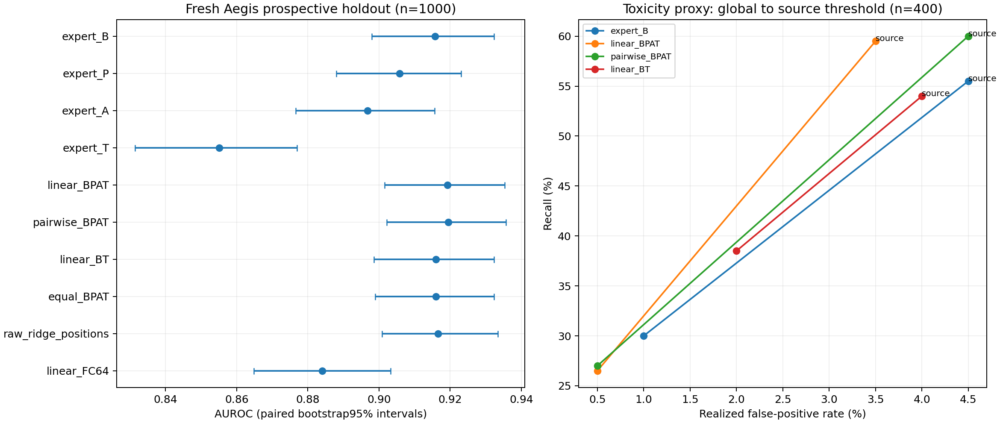

# 第二次改进尝试：条件融合与独立来源校准

2026-10-29完成。本轮在`experiment/conditional-fusion`执行，冻结提交`36168a4`早于新校准与测试评分。学校SSH已恢复；先前的认证阻塞已解除。23个候选、四个测试集合／六种阈值条件、138项指标组合均在服务器和本地复算通过。[完整结果](all-results.md)、[逐输入分数](heldout-scores.jsonl)、[复核记录](verification.json)、[冻结清单](freeze.json)保留，不按最终测试重选模型。

**结论：分数级加性融合在本轮同源主测试上有小幅排序增益，但没有同步提高既定阈值下的召回；显式交互项未证明额外收益。独立来源安全样本校准能明显缓解过于保守的迁移阈值，同时提高实际误报，不能视作模型识别能力提升。**

## 方向：保留强基线，检查可实现的互补增量

上一轮完整末位隐藏向量强于投影统计特征，多位置与分组PSO没有稳定超过该强基线。本轮不增加PSO预算，也不把更多高维特征直接混在一起，而是先训练四个专家，再用其训练折外分数学习融合。

|专家|输入信息|拟合方法|
|---|---|---|
|B|32层末位完整向量，131072维|固定lambda=1的ridge|
|P|32层四个用户输入相对区域完整向量，524288维|同一ridge|
|A|32层×32头×8项注意力统计，8192维|L2逻辑回归，C=.01|
|T|512维层间轨迹＋256维注意力／MLP模块统计|同一逻辑回归|

向量是归一化后的原始decoder层输出，位于最终norm之前，沿用上一轮提取边界。A包含跨区域注意力质量、熵和最大权重；T包含范数、位置／层间余弦、拒绝方向、熵与logit间隔轨迹及模块输出统计。

每个专家在1600条旧训练数据上五折交叉拟合：某行的专家训练分数来自未见过该行标签的训练折，中心化与标准化也只拟合训练折。这些分数用于训练元分类器；部署专家随后用完整1600条重拟合。600条旧开发数据仅用于预先指定最佳加性子集。B的均值、系数、截距及lambda与上一轮强末位头逐项完全一致。

穷举15个非空加性专家子集，另设四分数两两乘积的交互头、等权平均、四个单专家与旧多位置ridge／F-C64对照，共23个候选。元逻辑回归固定C=.1。交互头在四个主分数上增加六个乘积项，让一个信号的影响可随另一个信号变化。这里只选择四个专家，穷举即可，不需要PSO。

开发集最佳子集为BT（AUROC0.92638，B为0.92470），已在最终测试前固定；预注册主比较仍是四专家加性融合对B。

## 数据与实际执行

|新清单角色|条数|边界|
|---|---:|---|
|旧训练探针|64|只检查资源与特征一致性，不属于新测试|
|Aegis校准|800|400安全＋400不安全；阈值仅使用400安全分数|
|Aegis前瞻主测试|1000|官方训练分区中此前未使用的500／500|
|Aegis官方测试分区补充检查|120|60／60，样本较少|
|ToxicChat安全来源校准|400|人工标注非毒性，独立于测试|
|ToxicChat前瞻辅助测试|400|官方训练分区中此前未使用的200／200|
|ToxicChat官方测试分区补充检查|40|20／20，精度很有限|

共2824条，2760条新校准／测试输入。排除此前4800／3700／450／12条输入及精确／近重复；旧数据只通过64条明确标记的训练探针例外进入本轮新缓存。近重复采用原字符TFIDF连通分组，不能保证语义独立。所有模型共用相同新划分；本轮数值不与上一轮不同测试集直接比较。新增ToxicChat训练文件固定revision及字节哈希，物理CSV读取保留字段内换行；用途变更单独记录，未改写原下载记录。

64条资源探针通过：注意力统计前向中位耗时比1.1703，峰值已分配显存14.20GiB。完整提取327.50秒，缓存4099522752字节（3.82GiB），峰值已分配显存14.65GiB。八条作者函数一致性检查F误差为0；64条旧训练探针的P/X/S/A/M/F/L/Q最大误差全部为0。实际缓存、模型和tokenizer字节重新校验后才拟合检测器。训练53.47秒，独立评分及bootstrap133.76秒；均不含下载和部分封存耗时。

首次冻结提交因服务器缺少Git身份停止，未进入测试评分；沿用仓库原有提交身份后提交全部候选，生成预评估封存记录，再继续评分。模型、特征和候选未因该故障更改。基础模型没有训练，没有生成新攻击或调用付费API。

## 结果一：有小幅排序增益，没有低误报召回收益

以下都在同一1000条前瞻Aegis主测试上，阈值均来自各自独立Aegis安全校准400条，严格大于安全分数95%经验分位数判阳性。测试误报如实报告，不事后调到5%。

|方案|AUROC|相对B的配对95%区间|召回|误报|
|---|---:|---:|---:|---:|
|强末位B|0.91576|基准|65.6%|4.6%|
|四专家加性BPAT（预注册主比较）|0.91920|[+0.00087,+0.00619]|64.6%|4.2%|
|六乘积交互BPAT|0.91952|[+0.00094,+0.00670]|64.2%|4.2%|
|开发集预选BT|0.91597|[-0.00118,+0.00156]|68.8%|6.4%|
|等权BPAT|0.91598|[-0.00597,+0.00644]|66.2%|5.6%|
|旧多位置完整向量ridge|0.91663|[-0.00395,+0.00599]|67.8%|6.0%|
|旧F/C64|0.88408|[-0.04483,-0.01891]|54.6%|4.8%|

预注册加性融合的AUROC增加0.00344，配对区间在本轮同源主测试上排除零；但召回少5条，误报少2条，没有运行点收益证据。交互相对加性只增加0.000316，差值区间[-0.00078,+0.00150]包含零，不能声称显式交互优于简单加权。

开发集选择BT也未转化为主测试排序收益。它召回多16条，同时误报多9条：召回差区间[+1.8,+4.8]个百分点，误报差[+0.6,+3.0]个百分点，不能只报召回改善。

官方Aegis测试补充检查中B为0.89083、加性0.89583，差区间[-0.00723,+0.01695]包含零，B／加性实际误报均13.33%。ToxicChat前瞻辅助测试中B为0.91070、加性0.91258，差区间[-0.00773,+0.01133]包含零；官方ToxicChat小测试中为0.83500与0.81750。**尚无跨来源稳定融合增益证据，也没有5%误报保证。**

训练折外互补诊断中，B有267条漏检、40条误报；P/A/T分别命中其中41／39／26条漏检，并排除其中21／21／28条误报。这表明存在不同错误，但这些是已知标签后的oracle诊断，不能相加当作可部署融合收益；其他专家也有自己的新增错误。

另一个应保留的探索性线索：旧多位置ridge在ToxicChat前瞻测试AUROC为0.92317，相对B增加0.012475，配对区间[+0.00015,+0.02613]。但它在主测试的增益区间包含零，官方ToxicChat小测试又与B同为0.835；来源校准后的召回52.0%也未高于B的55.5%。这提示信号价值可能随来源变化，尚不足以据最终测试切换部署模型，尤其该项属于未作多重校正的探索比较。

## 结果二：来源安全校准有明显阈值效果

在400条ToxicChat前瞻测试上，只将阈值来源从Aegis安全400条换成独立ToxicChat非毒性400条，模型和测试分数保持不变：

|方案／校准来源|AUROC|召回|误报|
|---|---:|---:|---:|
|B／Aegis全局|0.91070|30.0%|1.0%|
|B／ToxicChat来源|0.91070|55.5%|4.5%|
|加性BPAT／Aegis全局|0.91258|26.5%|0.5%|
|加性BPAT／ToxicChat来源|0.91258|59.5%|3.5%|

B的来源校准带来召回+25.5个百分点（条件配对区间[+19.5,+31.0]），同时误报+3.5个百分点（[+1.0,+6.0]）；加性融合对应+33.0及+3.0个百分点。排序AUROC在两种阈值下严格不变。因此这是缓解过严迁移阈值的效果，不是特征或模型能力增加，也不是同误报率下的算法比较。

来源校准后的B误报率4.5%，Wilson95%区间[2.39%,8.33%]；加性为3.5%，区间[1.71%,7.05%]。官方ToxicChat小测试中B和加性实际误报均10%（2／20）。不能据这次较大的前瞻样本就宣称来源校准稳定控制到5%。毒性标签与有害输入标签也不是同一任务，结果单独报告。

## 验证边界与后续方向

20个训练折拟合的行排除记录保留；专家预处理仅在训练折拟合。所有候选、源码及依赖哈希在评分前封存并提交。独立复核覆盖2760条逐输入分数、23候选×六种条件的138项点指标、阈值次序、角色标签、分组隔离和来源校准的AUROC不变性。bootstrap为1000次标签分层成对重采样，每组一行；Wilson区间同时保留。点指标及阈值在Windows本地再次重算通过，bootstrap没有由另一套实现独立再生成。

区间以本次固定训练、开发选择和校准阈值为条件，不包含重训／校准采样波动；23候选的其他比较未作多重校正。OOF专家分数到完整训练专家存在分布变化；单模型、文本输入、两个数据来源、长度不超过512、近重复控制和较小官方测试均限制结论。前瞻训练分区留出不是官方测试或真正未知来源证据，也不是攻击成功率／完整多模态复现。

本轮可保留B作为默认低复杂度基线，BPAT作为小幅排序改进候选；目前不推荐增加显式交互或PSO预算。更值得下一轮验证的是**多个独立安全校准样本下的阈值稳定性，以及直接面向低误报召回的训练／选择目标**，而不是继续用全局AUROC挑选更复杂的头。需要预留新的最终测试，已评分数据只能作为后续开发或历史结果；来源校准需要预先知道来源并获得独立安全样本，当前不是自动未知域适配方案。
