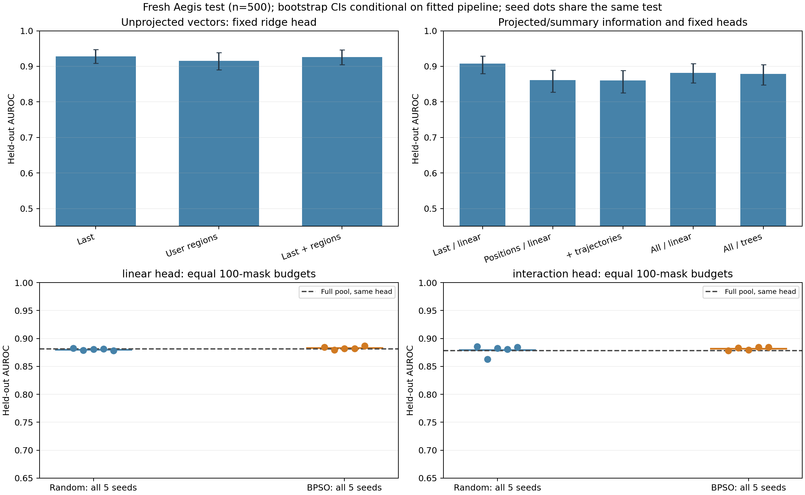

# 高维信息、交互与分组选择：第二轮实验报告

2026-10-28。47个预先冻结候选已完成独立评估；包括全部五种子结果，不按最终测试重选模型。完整数值见[全部结果](all-results.md)，逐输入分数见[heldout-scores.jsonl](heldout-scores.jsonl)，哈希与点指标复算见[verification.json](verification.json)。

**阶段结论：应该先建立完整向量的强基线，再判断新增位置、交互头与复杂选择器是否有增量。本轮确实扩展到了高维信息，但没有得到“更多位置＋更多信号＋PSO”稳定优于强末位向量基线的证据。**

## 一、这次实际抓了什么

与第一轮每层只有F/C两个数不同，这轮从同一次冻结模型前向提取：

|信息|保存与进入检测器的形式|
|---|---|
|各层最后输入位置与4个用户相对区间|32×5×4096维单位方向向量，私有缓存保留655,360个数；4个用户区间均值池化，末位单独保留|
|高维向量的固定投影|每个4096维向量用同一固定Rademacher矩阵投影到64维，合计10,240维；矩阵不拟合标签|
|逐token／跨层轨迹|每层16项，包括原始范数、相邻位置／层余弦变化、拒绝信号统计、预测熵及位置秩趋势|
|逐注意力头|32层×32头×8项，包括末位查询对系统前缀、用户四区间及模板后缀的注意力质量、熵和最大权重|
|Attention／MLP模块|每层8项模块输出范数及方向关系|
|原拒绝与参考几何|F32与训练集质心C32，作为已有信号对照|
|长度与缺失标记|6项廉价捷径对照|

实际分组候选池为**259组、19,270个标量**。搜索粒度为层×位置向量组、层×统计族，以及F/C/长度组；注意力各头有独立坐标，但搜索时成层分组。**这不是逐神经元或逐注意力头的穷举选择；投影坐标也不是单个神经元。**

另外保留三个未投影全向量ridge对照，分别用末位131,072维、用户区间524,288维、二者合并655,360维。它们在同一个ridge设置内比较位置增量，避免只在投影后的小表示中评价所有位置。

## 二、三类问题的结果

### 1. 新位置是否在强末位向量之上有增量？本轮未证实

同一ridge头、固定λ=1、训练集中心化和按组数平方根归一化：

|未投影向量|Aegis AUROC|危险召回TPR|安全误报FPR|
|---|---:|---:|---:|
|末位|**0.92837**|62.8%|3.6%|
|仅用户四区间|0.91515|60.8%|4.8%|
|末位＋用户四区间|0.92606|62.4%|3.6%|

合并相对末位的AUROC差为−0.00230，配对95%区间约为**[−0.00903,+0.00402]**，包含零。因此用户区间本身可用于区分标签，但当前池化／融合下没有确认它在末位之上提供新增收益。这也不证明箱内局部位置或其他对齐方式没有信息。

在固定投影＋逻辑回归分支，末位为0.90730，加入用户区间后为0.86120，差值区间[−0.06565,−0.02732]。这说明当前简单拼接并未有效利用额外位置，不能把“特征更多”直接等同于“性能更好”。可能原因涉及池化、投影、相关噪声、尺度与有效正则化；本轮没有分别隔离这些原因。

未投影ridge与投影逻辑回归的比较同时改变表示和估计器，**不能据此单独宣称“投影损失已被证明”**。本轮未事先冻结投影ridge这一交叉对照，不在看过测试后补做以挑选结果。

### 2. 轨迹、注意力与模块统计有没有用？有信号，但未超过强末位基线

|固定逻辑回归分支|Aegis AUROC|TPR|FPR|
|---|---:|---:|---:|
|F32|0.83669|42.8%|5.2%|
|F/C64|0.89816|53.2%|4.8%|
|末位投影向量|**0.90730**|64.4%|5.6%|
|全部位置投影向量|0.86120|49.6%|6.8%|
|位置＋轨迹|0.85997|50.0%|6.4%|
|位置＋轨迹＋模块|0.86178|49.2%|6.4%|
|仅注意力摘要|0.89877|55.6%|2.8%|
|全部候选信息|0.88154|50.0%|5.2%|

全部信息比“全部位置向量”增加0.02034 AUROC，配对区间[+0.00800,+0.03348]；但仍低于末位投影向量。这是相对一个受损基线的恢复，不能写成超越强基线的整体收益。注意力摘要单独有区分力且当前阈值误报较低，但它是否对强末位表示有条件增量，还没有单独的已冻结对照证明；注意力数值也不是因果贡献证明。

长度对照AUROC为0.43856，未显示本轮正向长度规则可直接解释全部结果；它不能排除主题、词汇、模板或来源捷径，困难正常样本和匹配主题的控制仍不足。

### 3. 引入交互头或PSO有没有独立收益？收益小且不稳定

固定ExtraTrees（32树、深度3）具备非线性交互能力，合成XOR检查通过；同样全部候选信息下Aegis AUROC为0.87840，逻辑回归为0.88154，配对差区间[−0.02562,+0.01808]。不能确认该交互头改善检测，也不能由此排除其他交互模型。两类估计器还具有不同归纳偏置与正则化，差异不能全部归于“是否存在交互”。

|头／搜索，五种子全部|Aegis平均AUROC|ToxicChat平均AUROC|
|---|---:|---:|
|线性／随机|0.88035|0.82806|
|线性／BPSO|0.88303|0.82998|
|树／随机|0.87925|0.65332|
|树／BPSO|0.88195|0.64122|

线性分支BPSO相对随机的五种子Aegis差值均为正，平均约+0.00268；毒性任务4/5种子为正，但一个种子下降约0.0232。树分支Aegis有输有赢，毒性平均更差。因此存在小幅同任务搜索收益线索，但不足以确认稳定的跨任务算法优势，且所有这些方案仍未超过强末位对照。

线性BPSO保留7,526–9,726个投影／统计坐标。L1在固定设置下仅18个非零系数、涉及12个组，Aegis AUROC0.89166，高于线性BPSO均值但低于末位投影基线。L1使用不同惩罚和选择粒度，不能当成完全相同搜索算法比较；它仍是不可忽略的简单压缩对照。其当前实现仍读取全向量，非零数不代表已实现推理加速。

每个头／方法／种子恰好100个不同非空掩码，五种子全部保存，共20个搜索运行。两头在各自比较中配置固定，随机与BPSO候选池、目标与预算一致；不是与上一轮500预算的直接算法比较。当前高维预算仅是有限pilot，不代表PSO所有变体与预算的能力上限。

## 三、排序能力与迁移阈值是两件事

ToxicChat按人类毒性标签单独评估，不能与输入有害性合并平均。未投影末位ridge AUROC为0.93700，但从Aegis校准后迁移的召回仅21.0%；误报0/100。后者的Wilson95%区间仍为[0,3.70%]，不能宣称真实误报率为零。合并位置ridge AUROC0.94230、召回19.0%，其相对末位AUROC差区间包含零。

全部信息树头ToxicChat AUROC只有0.63500，线性全部信息为0.84220，配对差区间完全为负。这提示当前树头和复杂信号组合迁移不足；不证明“交互在安全任务中无用”。

下一轮若研究阈值／校准，必须另取开发和最终数据；不能利用本轮毒性测试重调阈值后再当未见测试报告。

## 四、协议、成本与恢复记录

- 新清单3700条：训练1600、开发600、独立校准800（安全400）、Aegis新最终测试500、ToxicChat新毒性辅助测试200。全部旧4800／450／12条及近重复优先排除。校准取未使用的Aegis官方train，主测试取未使用的官方test；训练、开发、校准组独立。完整模板≤512 token，不截断。字符去重不能保证语义独立，主测试仍与训练同源，不是全新来源泛化证明。
- 所有质心、中心化、标准化与分类器只拟合训练集；随机投影固定、不拟合标签。搜索仅看开发集。47个候选、头、掩码和全部预处理代码依赖先封存，以`d03cc5e`提交后才启动测试。freeze SHA256为`2e37289f0e9d82d8a921d20e7729704ba64ab8bcad95f551cb1ad455e52c189b`。
- 各方法阈值只由400条独立安全校准输入的95%阶统计量决定，严格score>threshold，校准FPR均≤5%；测试实际误报照实报告，不移动阈值凑5%。500次配对分组bootstrap与Wilson区间均保存；区间以已拟合训练、选择、校准为条件，未做多重比较校正，也不包含跨重训不确定性。
- 冻结底座、原模型权重与tokenizer实际字节再次验哈希，全部新缓存数组逐字节封存并在训练和测试前复验。8条训练输入作者F逐层最大差0。基础模型未训练，不生成回答或新攻击。
- 64条训练样本注意力预检：成对中位前向时间比1.146，峰值14.20GiB，通过预设2倍／22GiB门槛。全3700条提取478.13秒，峰值14.65GiB，私有缓存5,371,187,424字节，低于6GiB上限；封存与实际模型复验29.15秒。
- 原串行训练停止在6个完整搜索运行，日志未记录退出原因。本地自动审批同时曾因额度上限拒绝终端操作，但不能据此断定服务器退出原因。保留旧日志与搜索记录，后续用8个独立拟合线程恢复，候选提案、模型、目标、种子与预算不变，批处理与串行PSO提案／结果顺序、并行模型预测均有一致性测试。
- 恢复训练用时510.86秒，包含重新拟合消融和旧赢家一致性验证；这是恢复阶段时间，不是整个实验总耗时。混合串行／并行、共享模型缓存和恢复只拟合旧赢家，导致每种方法的秒数不是独立速度基准。ridge用GPU float32解训练线性方程，逻辑回归／树估计器各单线程。
- 最终评估81.29秒。47个候选的全部点指标、头和代码哈希、20个搜索预算及1500条公开校准／测试分数已独立复算通过。原大缓存、模型和原始提示不入Git。

原始提取器SHA和实际报告保留在[提取日志](../../logs/highdim-extraction.json)。运行版本可由`4217b3c`恢复；之后修复完整缓存恢复时报告变量未定义问题，不改写原缓存来源。后续新提取器遇到不同代码／运行时身份会拒绝混用旧缓存。初始JSONL Unicode分隔符问题已修复，原始数据和划分未改。

## 五、阶段判断与后续优先级

1. **建立未压缩向量强基线。** 本轮末位高维向量已经很强，不应只围绕F/C摘要改优化器。原RCS／GraphShield等完整强基线仍待复现，不能称本轮优于它们或具有已确认新意。
2. **先找错误互补，再扩展交互选择。** 以训练折内的漏检、误报和来源留出为依据，寻找哪些位置／头／信号族对强末位模型有条件增量；控制表示、估计器、正则化和预算，避免因换多个组件而误判原因。本轮均值分箱可能丢箱内局部模式，尚未逐token／通道细粒度选择。
3. **暂不追加PSO预算。** 当前编码有小幅同任务收益，但不够稳定，也未胜过强表示／简单稀疏对照。只有条件增量及可重复组交互出现后，再论证分层、协同进化或自适应分配的必要性。

本轮500／200条最终测试已观察，后续一律不再当作未见最终测试。以上为一轮受限实验的阶段性判断，不是所有内部信息、交互模型或优化算法的否定结论。

