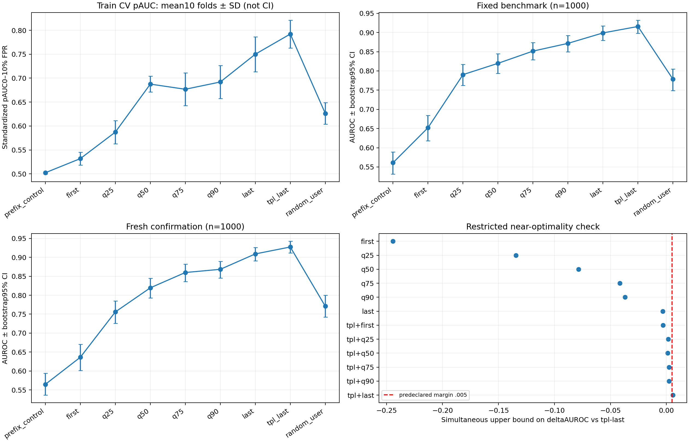

# R14—R15：真实token位置与末位互补实验交接

2026-10-29完成。[全部结果](all-results.md)、[CSV](all-results.csv)、[逐输入分数](heldout-scores.jsonl)、[独立复核](verification.json)、[CV选择](selection.json)及[汇总](summary.json)均保留。17个方案、170次训练折拟合、136项候选／测试条件已在服务器和本地核验；新确认集全部12个备选的5000次配对AUROC上界由独立sklearn逐次复算。

**交接结论：模板末位在本轮六个确定性用户单点候选中表现最强，选择它已有较强同场证据；末位与其他位置的组合未得到稳定增益。预先规定的“12个备选都不可能增加AUROC0.005”的近似不劣标准没有通过，因此仍不能宣称末位全局最优。当前保留原末位模型，不因测试点值更高而换组合。**

## 做了什么，哪些条件保持不变

R14比较九个真实token读出规则：固定公共前缀对照、用户首token、用户25%／50%／75%／90%处token、用户末token、完整模板末token、按输入ID确定的随机用户token。分位位置按用户token序号取floor(q*(长度−1))，不再取区域平均。短输入可能多个规则落在同一token，保留并记录，没有为某位置另换样本。

每个位置都取完整32层、每层4096维的单位化原始decoder输出，位于最终norm之前；单点131072维，无64维投影。R15增加六个“模板末位＋用户单点”组合、末位＋随机位置，以及重复末位对照，总计17个头。双点262144维，所有方案同一ridge lambda1、训练集中心化、sqrt(32×读出数)归一化。没有改变底座权重，也没有用PSO在这个小固定集合上搜索。

训练仍为原1600条。训练侧进行五折分组验证、重复两次（共170次折内拟合）；每折独立拟合均值与ridge。另在全1600条拟合17个最终头，600条旧开发数据仅作诊断，不参与本轮位置选择。以平均低误报pAUC(.1)选候选，并使用预先固定的一标准误启发式优先保留模板末位；重叠折的SE不是正式置信区间。

训练侧原始最优和最终预选均是`template_last`；最佳非末位单点是`user_last`，最佳真实双点是`template_plus_user_last`。这些名称在最终评分前已固定。

## 数据与可比性

- 固定基准v1保持不变：Aegis主测试1000、官方补充120；ToxicChat前瞻毒性辅助400、官方补充40；Aegis校准800及ToxicChat安全校准400。阈值仅使用各400条安全分数的95%阶统计量，严格大于阈值报警。
- 上轮400条确认样本此次明确标为历史补充测试，不当作新证据。
- 新取Aegis同源前瞻确认1000条，正常／危险各500，排除12122个旧ID及精确／字符近重复，选择只使用标签数量和去重关系。来自官方训练分区的未使用样本，不是官方测试或未知来源。
- 总6360条缓存含训练／开发2200、基准校准／评分2760、历史400和新确认1000。所有位置用完全相同输入，完整模板≤512token，不截断。

5360条继承输入的模板末位向量与原缓存最大差为0；重新拟合的末位头均值、系数、截距与旧B完全一致。3160条历史评分输入的B分数最大差为0。新确认上B的0.92729与统一主测试的0.91576差异来自样本不同，不是模型提升；统一主基准从未更换。

特征提取326.87秒，私有float16缓存15005122688字节（约13.98GiB），峰值allocated约14.20GiB；训练／CV149.26秒，最终评分154.95秒，时间不含全部加载、封存和独立复算。缓存、模型／tokenizer实际字节封存通过。

## 结果：真实用户单点

下表每一列内部都是同一套输入和同一估计器，不能跨列把基线分数差当优化收益。

|读出位置|固定Aegis主测试AUROC|新1000条确认AUROC|新确认召回|新确认误报|
|---|---:|---:|---:|---:|
|用户首token|0.65216|0.63627|7.0%|5.2%|
|用户25%处|0.79037|0.75590|27.2%|6.4%|
|用户50%处|0.81981|0.81951|40.8%|6.2%|
|用户75%处|0.85163|0.85993|43.0%|3.4%|
|用户90%处|0.87182|0.86836|46.8%|5.4%|
|用户末token|0.89896|0.90900|61.4%|5.2%|
|完整模板末token，原B|**0.91576**|**0.92729**|**67.4%**|6.0%|
|随机用户token|0.77845|0.77094|29.4%|5.2%|

用户末位相对模板末位在新确认上AUROC差−0.01830，配对95%区间[−0.02941,−0.00740]。六个确定性用户单点的Bonferroni同时上界全部低于0，最接近的是用户末位，上界约−0.00337；在这组单点、当前训练与估计器设置下，模板末位优势有配对证据。

“用户末位”已经看完用户内容，仍不如模板末位，提示差异不只是看到多少用户文本。模板后缀、token身份一致性、回应阶段表示和分类器归纳偏置等都可能有关，本轮没有分离这些机制，不能直接归因为某个神经因果解释。也没有证明用户中间状态无信息：其中多个单点本身有明显区分力。

## 结果：增加位置是否有帮助

|方案|固定主测试AUROC|新确认AUROC|新确认pAUC(.1)|新确认召回／误报|
|---|---:|---:|---:|---:|
|模板末位|0.91576|0.92729|0.78221|67.4%／6.0%|
|模板末位＋用户50%|0.91259|0.92137|0.77179|66.0%／5.6%|
|模板末位＋用户90%|0.91511|0.92258|0.78571|68.4%／5.2%|
|模板末位＋用户末位|0.91398|0.92786|0.78897|66.6%／6.2%|
|模板末位＋随机用户位置|0.90742|0.91810|0.77577|66.8%／6.0%|
|重复模板末位|0.91576|0.92729|0.78221|67.4%／6.0%|

最佳真实双点在新确认上的AUROC只增加0.000564，配对95%区间[−0.00337,+0.00461]包含零；pAUC增量区间[−0.00608,+0.02080]也包含零，召回少0.8个百分点、误报多0.2个百分点，不能认定改善。

“模板＋用户90%”的新确认召回／误报点值较好，但召回差区间[−1.4,+3.4]个百分点、误报差[−2.4,+0.6]个百分点均包含零，且固定主测试pAUC更低；不根据新测试将它换成最终方案。

ToxicChat单独按毒性代理任务报告：模板末位AUROC0.91070，用户末位0.86783，二者组合0.91450，组合增量区间[−0.00763,+0.01538]包含零。来源安全校准后组合召回59.5%／误报4.0%，B为55.5%／4.5%；这仍是探索性点值，不与有害输入主任务混合，也不代表稳定跨来源收益。

重复末位的最大分数差仅1.67e−6，所有主要点指标相同，符合相同能量归一化下ridge核应保持不变的对照预期。随机位置加入后也没有改善。这比仅比较特征维度翻倍更能排查缩放／容量解释，但不能完全隔离表示与有效正则化的作用。

## 为什么仍不能说“证明末位最优”

本轮事先规定12个真实备选：六个用户单点、六个末位＋用户点。使用5000次标签分层配对bootstrap，计算每个备选相对末位AUROC增量的单侧同时上界，分位数1−.05/12；预设工程容差为0.005。容差不是领域通用标准，bootstrap上界也不是分布无关保证。

新确认上11个备选的上界低于0.005，但“模板末位＋用户末位”的上界为**0.00584868**，高于0.005，因此预设近似不劣条件为**False**。固定主基准也有上界0.00632068超过容差。没有事后放宽容差、删掉比较或将未显著差异当作最优证据。

可以支持的结论是：**本轮固定单点集合中模板末位表现最强，未确认多点组合具有增量；仍有小幅组合收益的不确定性。** 无法覆盖所有token、逐层位置搭配、输入自适应规则、其他检测器／正则或其他模型，因此不存在全局最优证明。

## 前缀负对照与数值诊断

前缀对照取由模板本身确定的固定公共token位置（模板单独编码长度减3），全部输入在它之前的token ID严格相同，避开用户边界分词向前合并的影响。它仍在变长FP16执行中出现最大约9.77e−4的向量漂移；新确认AUROC为0.56477，低误报pAUC仅0.50427，既定阈值的召回／误报均为0。

在32条训练探针上保留原输入内容、改为统一512长度并正确屏蔽右侧padding后，公共前缀向量最大差降至0；模板末位也有约9.77e−4的数值变化。这支持形状相关浮点执行差异的解释，不能将前缀弱相关解释成它通过因果注意力看到了用户后文。本轮主结果仍使用与原B完全一致的变长管线，固定形状只作标签无关诊断；未完成所有输入的固定形状鲁棒性复验，长度／数值／模板捷径不能全部排除。

## 复核、接续记录与交接入口

复核覆盖170个训练折的行排除与OOF分数、训练侧选择规则、全部136项点指标、400条独立安全样本阈值、角色／分组隔离、17个模型及代码／缓存哈希。新确认末位的5000次AUROC区间与全部12个备选上界都由独立sklearn逐次重建；服务器和Windows均通过。其他数据条件的上界使用相同已测试实现，未全部用第二实现重跑。

审查修复了实际封存与副本绑定、指标代码依赖清单及独立验证遗漏。评分首次在Git字节门槛被拦住：旧模型清单的CRLF与提交中的LF不同，JSON内容及除行尾外的字节相同。原文件、首版冻结与首次评分封存均保留；只规范化依赖字节、以`0620355`提交新封存后才评分，所有模型、CV和选择保持一致，见[规范化审计](canonicalization-audit.json)。该记录不是按测试结果调参。

交接后可直接运行`python configs/positions/verify.py`验证公开交付文件，运行`python configs/positions/report.py`重建表格和图。实际原始token缓存留在学校`~/HiddenDetect-reproduction/cache/positions/P.npy`，不入Git；不要覆盖冻结缓存或在已评分样本上重新挑选后宣称新验证。未使用配额重置卡，没有底座训练、新攻击或付费API。

后续优先方向是：**细扫用户末端和模板后缀附近的真实token，并控制token身份／固定执行形状。** 若扩展到群体优化，可尝试“每层选一个位置”的分类编码，使每个方案保持32×4096维、显式保留全末位方案，再用严格训练侧验证判断是否有条件增量；这是待验证方案，不是本轮已执行结果。固定统一基准继续保留，新1000条确认从此成为历史结果，下一轮另取新确认。
