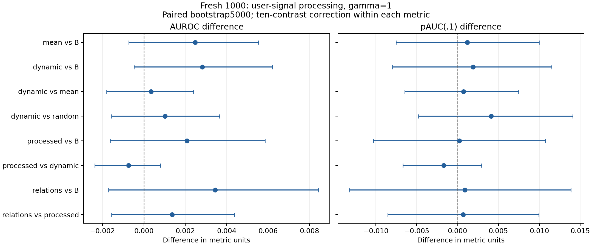

# R19—R22：用户信息加工实验交接

**交接结论：用户摘要的加入出现了小幅正向线索，尤其是普通均值与动态摘要；但十项对照校正后尚不能确认增益，更未证明复杂加工优于简单均值。保持原末位模型，同时优先复核这条增量线索。**

固定基准v1与train1600/dev600不变；新的Aegis1000确认排除所有旧输入及近重复，仍是同源确认，不是新领域。所有候选在评分前提交冻结。

## 这次加工什么

第8、16、24、32层的全部有效用户token，保留完整4096维方向，不作随机投影。普通均值、末位对用户的注意力加权、相对残差变化加权、变化加权的单位跨层增量、Attention模块增量、MLP模块增量，以及确定性随机权重对照，共7类摘要。局部—整体关系共116项，包括余弦、距离、范数、权重熵和模块方向关系。
跨层／模块增量是对内部向量的观察，不是因果归因；没有训练底座、没有生成回复。固定512、有正确mask，排除前缀／后缀／补齐token。

## 匹配控制与训练

- R19 mean：末位完整向量＋普通用户均值。
- R20 dynamic：注意力加权＋变化加权的用户状态。
- R21 processed：dynamic再加入跨层／Attention／MLP增量。
- R22 relations：processed再加入局部—整体关系。
- 随机权重对照random；重复5份普通均值duplicate_mean，归一化后应与mean数学等价。
全部使用同一lambda1中心化岭回归。G=G_B+gamma G_E，gamma只取预设.25和1；关系块固定权重.1。13个候选、重复5折两次，共130折；关系标准化仅拟合训练折。开发集仅诊断。
最终CV选择 `B`，原始CV最佳 `mean_g1p0`；一SE规则是启发式，不是正式置信区间。
新缓存1631990784字节；旧末位读出最大差0.0；固定前缀差0.0。

## test_aegis_holdout:global

|方案|AUROC|pAUC(.1)|召回|误报|
|---|---:|---:|---:|---:|
|B|0.915744|0.795032|65.6%|4.6%|
|mean_g0p25|0.917208|0.797895|67.8%|5.4%|
|mean_g1p0|0.919000|0.800737|70.8%|7.2%|
|dynamic_g0p25|0.916748|0.797895|67.2%|5.6%|
|dynamic_g1p0|0.917612|0.799895|68.0%|5.2%|
|processed_g0p25|0.916564|0.797284|66.4%|5.2%|
|processed_g1p0|0.917448|0.799937|70.0%|6.0%|
|relations_g0p25|0.917072|0.796884|67.4%|5.2%|
|relations_g1p0|0.917628|0.797411|69.0%|5.6%|
|random_g0p25|0.916884|0.797116|66.2%|4.8%|
|random_g1p0|0.918064|0.798379|68.8%|5.6%|
|duplicate_mean_g0p25|0.917208|0.797895|67.8%|5.4%|
|duplicate_mean_g1p0|0.919000|0.800737|70.8%|7.2%|

## confirmation_aegis:global

|方案|AUROC|pAUC(.1)|召回|误报|
|---|---:|---:|---:|---:|
|B|0.919636|0.809326|69.4%|5.6%|
|mean_g0p25|0.920840|0.810505|71.4%|6.2%|
|mean_g1p0|0.922112|0.810505|73.6%|6.8%|
|dynamic_g0p25|0.920660|0.810463|70.4%|6.2%|
|dynamic_g1p0|0.922460|0.811221|71.2%|5.6%|
|processed_g0p25|0.920748|0.810147|69.6%|5.8%|
|processed_g1p0|0.921720|0.809537|72.0%|6.0%|
|relations_g0p25|0.921972|0.810400|70.4%|5.8%|
|relations_g1p0|0.923084|0.810211|70.8%|6.0%|
|random_g0p25|0.920616|0.810063|70.4%|5.8%|
|random_g1p0|0.921440|0.807116|72.2%|6.4%|
|duplicate_mean_g0p25|0.920840|0.810505|71.4%|6.2%|
|duplicate_mean_g1p0|0.922112|0.810505|73.6%|6.8%|

## 新确认：预注册十个对照

以下为gamma1；gamma.25及固定旧基准比较为描述性。5000次分层配对bootstrap，按十个对照作每种指标内Bonferroni修正，AUROC与pAUC分开解释；条件于固定训练和校准，不涵盖完整重训不确定性。

|对照|ΔAUROC|修正区间|ΔpAUC|修正区间|
|---|---:|---|---:|---|
|mean_vs_B|+0.002476|[-0.0007201199999999988, 0.005528000000000033]|+0.001179|[-0.007537052631578909, 0.009979052631579003]|
|dynamic_vs_B|+0.002824|[-0.00047608000000014304, 0.006212040000000058]|+0.001895|[-0.007958105263157843, 0.011515894736842117]|
|dynamic_vs_mean|+0.000348|[-0.001802009999999859, 0.0023960200000000135]|+0.000716|[-0.0064634736842105215, 0.0074736842105263546]|
|dynamic_vs_random|+0.001020|[-0.0015600400000000058, 0.0036600600000000643]|+0.004105|[-0.004769526315789483, 0.014105263157894732]|
|processed_vs_B|+0.002084|[-0.0016260299999999613, 0.005854049999999925]|+0.000211|[-0.010315894736842173, 0.010758421052631714]|
|processed_vs_dynamic|-0.000740|[-0.002364039999999921, 0.0007900099999999039]|-0.001684|[-0.0066842631578947955, 0.0029473684210526434]|
|relations_vs_B|+0.003448|[-0.0017040799999999284, 0.008434129999999969]|+0.000884|[-0.013263263157894705, 0.01385263157894745]|
|relations_vs_processed|+0.001364|[-0.0015600599999998949, 0.004374010000000103]|+0.000674|[-0.0085264210526315, 0.009936947368421215]|
|selected_vs_B|+0.000000|[0.0, 0.0]|+0.000000|[0.0, 0.0]|
|duplicate_vs_mean|+0.000000|[0.0, 0.0]|+0.000000|[0.0, 0.0]|

## 证据边界

比较加工方法是否增加信息，需同时看相对B、普通均值和随机权重对照；不能把候选中的测试最高值当成预选赢家。维度／正则化也会影响结果；重复均值只是维度冗余对照，并未完全匹配所有统计容量。
这里只检查四个固定层的指定汇总，不能否定其他层、学习型聚合或用户片段方案。注意力权重不自动代表token的因果重要性。

旧固定末位分数最大差2.220446049250313e-15，重复均值分数最大差7.327471962526033e-15。
完整候选、各来源和召回／误报区间见evaluation.json；逐样本归档heldout-scores.jsonl；训练折与选择见cv.json/oof.npz/selection.json。
复核：`python configs/processing/verify.py --bootstrap`；服务器加`--actual`校验私有缓存。

## 结果应当怎样解释

**这里不宜简单说“加工方向失败”，也不能宣布“复杂加工已成功”。** 本轮所有主要加工候选在固定主基准和新确认上的AUROC点值都高于B，是值得保留的线索；但复杂加工的独立贡献尚未确认。

- 普通均值：固定主基准0.915744→0.919000，新确认0.919636→0.922112。新确认差+0.002476，普通95%区间[+0.000300,+0.004628]；十对照修正后[−0.000720,+0.005528]。不能忽略小幅改善，也不能跳过预定校正。
- 动态摘要：新确认AUROC0.922460，差+0.002824，修正区间[−0.000476,+0.006212]。相对普通均值只高0.000348、相对随机权重高0.001020，两者修正区间都包含零，尚不能归功于特定注意力／变化加权规则。
- 模块与跨层增量：新确认0.921720，没有确认比dynamic额外改善。processed的五类摘要共同按组归一化，相比dynamic也改变各组相对权重，所以这个比较不构成单一模块的因果消融。
- 关系特征：新确认点值最高0.923084，相对B差+0.003448，修正区间[−0.001704,+0.008434]。比processed高0.001364，但修正区间[−0.001560,+0.004374]；在固定主基准也没超过普通均值。该块含116个关系及强度统计，不是单独的乘法交互项。

普通均值在旧Toxic400的AUROC由0.910650升到0.918875，仅作为已观察的毒性辅助任务上的描述性支持，不等同于新来源危险指令验证。

## 召回与误报

新确认中，B召回69.4%／误报5.6%；普通均值73.6%／6.8%，召回提高伴随误报增加。动态摘要71.2%／5.6%，在本批样本的误报点值相同，召回高1.8个百分点；普通95%召回增量区间[+0.2,+3.6]个百分点，十对照修正后为[−0.4,+4.2]个百分点，不能据此保证未来同误报收益。pAUC增量也未确认。

## 对照与复核

重复普通均值与单份普通均值的指标完全一致，最大分数差约7.33e−15；旧固定末位分数最大差约2.22e−15。三项真实训练折的原始／对偶解最大分数差约2.56e−14。所有91项测试条件、130个训练折指标与5000次配对bootstrap在计算服务器及Windows归档两端重放通过。

首次缓存创建、归一化形状和分析模块导入问题均留有记录。前两项在正式完成任何缓存断点前修复；导入修复前没有生成指标文件，模型、选择与分析函数内容保持不变，修复前后逐样本分数文件SHA256完全一致。原封存、原pre-evaluation seal与修复审计保留在本目录和logs/processing-*.json，不覆盖历史证据。

缓存manifest沿用了旧轮token对齐字段`readouts/routing_indices`，用于对齐旧基线；本轮7类摘要与116项关系的实际布局以cache seal的metadata和processing_core为准。

## 下一步建议（尚未执行）

收窄到B、B＋普通均值、B＋动态摘要，先做5次训练重采样与更大的新确认集，预先固定少量比较，观察排序增量和低误报召回能否重复。保留关系特征为探索候选，待简单摘要收益确认后，再细分关系、权重及模块来源，避免同时增加很多自由度。主题／长度／来源捷径尚未排除；没有全token空间或因果机制最优的证明。

绘图复现：`python results/processing/plot_results.py`。本轮未使用配额重置卡。
