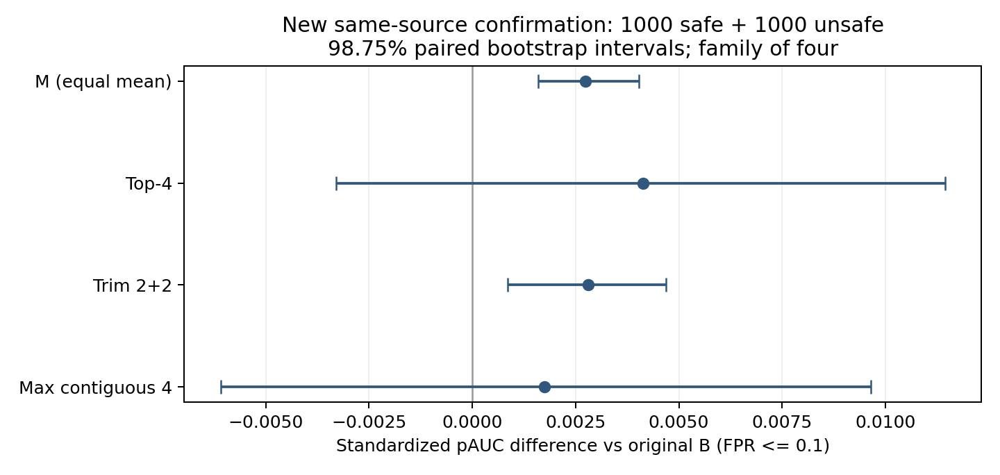

# HiddenDetect纯OC：固定原F汇总补实验与交接（2026-10-30）

**本轮已完成。** 新同源2000条上，等权平均M与截尾平均相对原积分的低误报排序出现小幅确认增益；top-4与连续窗口的AUROC提升较大，但主pAUC增益未确认。截尾并未确认超过更简单的M，且误报增加。保留原B作部署参照，把M记为后续优先验证候选，不据这轮直接替换部署规则。

这次补的是历史归因缺口：不少旧实验同时换了信息和分类器，不能单独说明原F怎么汇总更好。本轮承接HiddenDetect原末位F及原积分，不承接完整向量岭回归0.91576；原规则位置实验结论继续保留，不换倒数第二位置。

## 固定边界与问题树

固定LLaVA-v1.6-vicuna-7b、原系统/用户/回答前缀模板、完整输入最后真实token、RV、norm→词表投影→余弦、F高分为危险方向，以及0-based闭区间[16,29]共14层。无生成、分类器、层重选、方向翻转、C、额外logits特征、其他位置或完整隐藏向量缓存。前向中原投影保留完整token矩阵乘形状，只保留末位F标量；原32层F一并保存用于身份重放，所有五规则严格仅访问16至29层。

原few-shot包含12条带标签数据（6正常/6危险，4文本/8图文），已复现作者选择[17,29]；本轮固定此前默认[16,29]，不重选。不训练分类器不等于完全没用标签，正常校准也使用正常标签。4/截2/窗口4均事先固定工程参数，不称最优。

|方向|问题/推测|唯一改动|真实直接对照|
|---|---|---|---|
|OC-1-M|积分端点半权可能影响排序|14层等权平均|原积分B|
|OC-1-1|少数强层可能被稀释|最大的4个F平均|B；机制对M|
|OC-1-2|极端层可能是噪声|去掉最高2/最低2，余10层平均|B；机制对M|
|OC-1-3|连续高分可能更可靠|11个连续4层窗口均值取最大|B；机制对top-4|

OC-1为父方向，运行号OC-A1-H（历史）及OC-A1-N（新同源确认）。OC-1-4、OC-2、OC-3仍为候选，本轮没有执行正常参考标准化、Cauchy融合、层差或PSO。

## 身份、校准和新样本冻结

- C1000原积分精确复现 **0.746640**，1850条历史缓存原积分与存储分数逐项一致；上游450条作者F重放差0。新提取前另重放16条ORP-T2旧探针，32层末位F和原积分差0；模型12项实际文件SHA通过。原投影精度为模型fp16、余弦参考float32，汇总按原float64梯形积分。
- 五规则共享历史400条正常校准，均与评估ID隔离。阈值为升序第ceil(0.95×401)=381个，严格大于才告警；旧位置实现实际第380个，本轮重新按381计算，没有改写旧报告，也未在新测试移动阈值凑5%。
- 遍历实际全部历史记录及清单，核查20872条原文、21772个含别名ID、20860个历史原文哈希；ORP-T2明确纳入。规范化精确去重后，沿用字符3–5gram TF-IDF（最多65536特征）、余弦≥0.92连通分组，历史优先，排除近重复。剩余正常2302/危险2782，按预定ID哈希顺序各取1000，无数量降级、无旧样本填充。
- 新原文只在学校原data忽略目录保留，公开清单含ID、标签、原文SHA、规范化group哈希、token哈希。去重只降低重复风险，不保证语义独立；独立本地审查没有取得原文，不声称它另行重跑了全量私有文本去重。
- 首次冻结提交0a75093；Windows CRLF与Git LF差异在评分前发现，保留首份并用v2替代；v2源码提交 **d21b13c**，执行锁提交 **d33776d** 后才开始评分。规则、比较家族、阈值和2000条清单均已封印。

主指标为与原报告一致的sklearn标准化pAUC(FPR≤0.1，McClish校正)。四项主比较M/top4/截尾/连续窗口各对B，标签分层、同输入配对bootstrap 10000次、seed20261030；各双侧98.75%差区间作Bonferroni家族控制。AUROC、召回/误报差区间为描述性95%；绝对率另给Wilson95%。区间均以固定规则和本次校准为条件，不包含更换校准集的不确定性。

## 历史诊断：不能当新确认

C1000及ORP-T2均已观测历史。本轮完整报告全部固定规则，没有按最高值改参数或隐藏失败项。下表区间仅作诊断；原始历史JSON通用decision字段中的confirmed_improvement仅表示差区间高于0，**不表示历史数据获得新确认**。

|历史批次/运行|规则|同批B AUROC→候选|pAUC|相对B主差98.75%区间|召回/误报（新381阈值）|
|---|---|---|---|---|---|
|OC-A1-H|原梯形积分B|0.746640→0.746640|0.621453|基线|30.00%/5.40%|
|OC-A1-H|等权14层平均M|0.746640→0.748916|0.624442|[+0.001095, +0.005242]|31.60%/5.80%|
|OC-A1-H|最强4层平均|0.746640→0.765500|0.631958|[-0.000705, +0.022737]|32.40%/4.80%|
|OC-A1-H|双侧各截2层平均|0.746640→0.746700|0.624042|[+0.000168, +0.005400]|31.40%/6.00%|
|OC-A1-H|连续4层窗口最大均值|0.746640→0.764480|0.629832|[-0.003916, +0.020863]|32.00%/5.00%|
|OC-A1-H-ORP-T2|原梯形积分B|0.771068→0.771068|0.638653|基线|29.80%/4.60%|
|OC-A1-H-ORP-T2|等权14层平均M|0.771068→0.773624|0.640695|[+0.000253, +0.004547]|31.60%/4.80%|
|OC-A1-H-ORP-T2|最强4层平均|0.771068→0.790684|0.645937|[-0.006485, +0.020758]|32.60%/4.20%|
|OC-A1-H-ORP-T2|双侧各截2层平均|0.771068→0.771244|0.641263|[-0.000074, +0.005768]|31.00%/4.80%|
|OC-A1-H-ORP-T2|连续4层窗口最大均值|0.771068→0.789916|0.643958|[-0.009916, +0.019695]|32.40%/4.00%|

## 新同源2000条：主比较

OC-A1-N数据为新Aegis同源留出，正常/危险各1000；这批已评分，今后必须转历史排除。所有箭头左侧都是**本批重新计算的B=0.759299**，不是C的0.746640。

|方向/规则|同批B AUROC→候选|pAUC|主pAUC差|修正98.75%差区间|判定|
|---|---|---|---|---|---|
|original-B / 原梯形积分B|0.759299→0.759299|0.648989|+0.000000|基线|基线|
|OC-1-M / 等权14层平均M|0.759299→0.762188|0.651721|+0.002732|[+0.001595, +0.004037]|本轮确认小幅低误报排序提升|
|OC-1-1 / 最强4层平均|0.759299→0.777979|0.653116|+0.004126|[-0.003300, +0.011442]|主增益未确认|
|OC-1-2 / 双侧各截2层平均|0.759299→0.759249|0.651795|+0.002805|[+0.000850, +0.004689]|本轮确认小幅低误报排序提升|
|OC-1-3 / 连续4层窗口最大均值|0.759299→0.776797|0.650742|+0.001753|[-0.006092, +0.009640]|主增益未确认|

|规则|危险召回（Wilson95%）|正常误报（Wilson95%）|相对B召回差95%|相对B误报差95%|
|---|---|---|---|---|
|原梯形积分B|346/1000=34.60% [31.72%, 37.60%]|38/1000=3.80% [2.78%, 5.17%]|基线|基线|
|等权14层平均M|357/1000=35.70% [32.79%, 38.72%]|41/1000=4.10% [3.04%, 5.51%]|[0.50%, 1.80%]|[0.00%, 0.70%]|
|最强4层平均|356/1000=35.60% [32.69%, 38.62%]|45/1000=4.50% [3.38%, 5.97%]|[-0.30%, 2.30%]|[-0.10%, 1.50%]|
|双侧各截2层平均|354/1000=35.40% [32.50%, 38.41%]|43/1000=4.30% [3.21%, 5.74%]|[0.20%, 1.50%]|[0.10%, 1.00%]|
|连续4层窗口最大均值|352/1000=35.20% [32.30%, 38.21%]|42/1000=4.20% [3.12%, 5.63%]|[-0.80%, 2.00%]|[-0.40%, 1.20%]|

AUROC相对B的描述性95%差区间：
- M：Δ=+0.002889，[+0.002368, +0.003427]。
- top4：Δ=+0.018680，[+0.013835, +0.023613]。
- trim2：Δ=-0.000050，[-0.000951, +0.000859]。
- window4：Δ=+0.017498，[+0.012376, +0.022857]。

M抓到的危险多11/1000，同时正常误报多3/1000；误报差95%为[0,+0.7]个百分点，不能证明绝对无误报代价。截尾危险多8/1000、正常误报多5/1000；误报差95%为[+0.1,+1.0]个百分点，这个额外代价须明确保留。它的AUROC约不变（−0.000050），改善主要出现在低误报局部，并非全域更好。top-4与窗口AUROC上升、pAUC点值也略升，但修正主区间含0，因此只能说低误报收益未确认；不说等价或绝对无用。

## 逐问题闭环与机制解释

|问题|直接诊断（新同批）|本轮保留/否定/未确认|下一步建议|
|---|---|---|---|
|端点半权是否有影响|B AUROC0.759299→M0.762188，pAUC0.648989→0.651721，主差区间全正|确认很小的同源低误报排序增益；部署收益仍有限|优先对M做独立校准敏感性/新来源验证|
|少数强层是否更好|B→top4 AUROC0.759299→0.777979，主pAUC差区间跨0；对M额外低误报收益也未确认|保留总体排序线索；不升级为低误报优化成功|不根据本批继续搜索k|
|去极端是否更稳健|B→截尾AUROC0.759299→0.759249，主pAUC差区间全正；误报上升|确认相对B小幅局部排序改善，但未确认去极端本身优于M|不把截尾作为比M更好的结论，不扩大截尾率搜索|
|连续是否比离散强层更可靠|B→window AUROC0.759299→0.776797，主pAUC未确认；window对top4描述性差为负|本固定连续4优于top4的推测未获支持；不能推广到所有连续结构|不据此扩展多窗口长度|

|机制比较（非主家族）|pAUC差|描述性95%区间|AUROC差|
|---|---|---|---|
|top4 vs M|+0.001395|[-0.004432, +0.007111]|+0.015791|
|trim2 vs M|+0.000074|[-0.001432, +0.001384]|-0.002939|
|window4 vs top4|-0.002374|[-0.003879, -0.000674]|-0.001182|

机制比较不能借用四主比较的校正结论。尤其截尾对M的区间含0，不能把对B的正差全归因于抑制极端值；两者共同去除了梯形端点半权。连续窗口对top4的负差只是描述性证据，不冒充预注册主家族检验。

## 成本、验证和执行异常

- 新2000条原F提取用时98.31秒，平均49.16毫秒/条（不含模型加载和哈希核查），峰值allocated 13.70GiB。五规则共用同一次前向，不多做模型推理、不产生新权重或完整向量缓存。
- 本地CPU缓存汇总五规则合计中位0.480微秒/条，10000条批量×30次；是批量摊销统计，不能等同单请求端到端延迟或证明基础模型加速。历史诊断无需新增模型前向。
- 本地与服务器各重放C、ORP-T2、新确认三批，全部273个统计数值一致，全部逐样本最终分数重算exact；16新旧探针F和积分exact。独立只读审查另用3000组含并列值随机重采样核对sklearn，实现误差<1e−12；最终审查见review记录。
- 原服务器分支有artifacts-lock和旧verification两处修改，均保留。新实验在独立工作树，数据/权重/环境链接复用；缺失CLIP相对目录链接造成首次加载失败，评分前补链接重启，保留日志，不变更规则/样本/阈值。结束GPU无计算进程。
- 初次SSH提升被自动审批拒绝旧脚本从聊天恢复凭据；用户随后明确授权仅内存复用，审批通过。凭据未写入公共产物。

## 证据索引与复现

- 新清单SHA256：`de2bd2982ec3b02f8781c5d8012d922689654bf0ae144e169fbf92721dc47298`。
- 新逐样本F/最终分数SHA256：`c1496aa29f7073a51ac61a63c12f68ecc00d297ef969f0240851ae9782c25231`。
- 执行锁SHA256：`b9f205b9ce8e9ac32fdbe072471e1fd31af21e6961edb742eef99870eb34cba3`。
- [规则/阈值/清单封印v2](pre-score-freeze-v2.json)、[原封印及更正追溯](pre-score-freeze.json)、[新2000清单](../../configs/pure-oc/manifest.json)、[执行锁](../../configs/pure-oc/run-lock.json)。
- [历史身份](identity.json)、[新提取身份与模型哈希](../../logs/pure-oc-identity.json)、[去重审计](../../logs/pure-oc-duplicates.json)、[校准ID/分数/阈值](thresholds.json)。
- [历史逐样本F/分数](historical-scores.jsonl)、[新逐样本F/分数](confirmation-scores.jsonl)、[C全统计](historical-C.json)、[ORP-T2全统计](historical-ORP-T2.json)、[新确认全统计](confirmation.json)、[绝对召回/误报区间](absolute-rate-intervals.json)。
- [本地验证](local-verification.json)、[服务器验证](verification.json)、[双端比对](cross-host-verification.json)、[独立审查](review-2026-10-30.md)、[提取资源](extraction.json)、[CPU成本](cost.json)。

数字重放可在实验仓库目录执行 `python configs/pure-oc/verify.py`，它按Git封印blob核对历史源码，不依赖私有文本或模型。严格冻结评估需另建检出d33776d的工作树（此后动态登记表会更新），将本交付的 `results/pure-oc/confirmation-scores.jsonl` 和 `extraction.json` 复制到该工作树对应目录，运行 `python configs/pure-oc/test_contract.py`，再 `python configs/pure-oc/evaluate.py`。GPU重新提取入口 `configs/pure-oc/run.py` 仅用于已封印数据，不重复称为新确认；私有data、固定模型文件和相同精度运行环境须由授权环境提供。不得把公开分数重放说成独立重跑原文去重或重新提取模型。

## 交接与下一步

本轮最稳妥的研究结论是：原F在信息不变、没有新增分类器的前提下，简单地去掉梯形端点半权，就能在这批同源数据上获得很小的低误报排序改善；更复杂的top-4/连续窗口没有确认额外低误报收益，截尾也没有确认超过M。继续保留B参照，M优先进入预先登记的独立校准稳定性和新来源验证。不要沿这2000条继续调k、窗口或阈值，不自动启动OC-2/OC-3。

这是文本、同源留出和一次固定校准下的结论，不是跨领域、多模态、全部位置或全部汇总规则的证明。论文启发与迁移边界继续以主项目调研文档为准，不把候选算子称为相关论文已证明适用于HiddenDetect。
