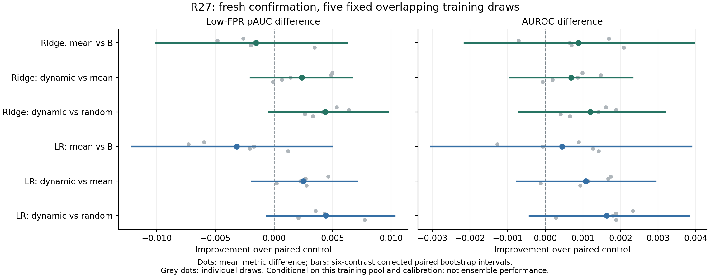

# R27：用户摘要的训练稳定性验证

**本轮结论：用户摘要仍有信息线索，但没有确认稳定补强末位，继续保留末位＋岭回归作为参照。** 新确认中动态摘要平均AUROC最高，却没有在预先指定的低误报区域指标上形成可靠增量；普通均值在旧基准上方向一致，在新确认上没有重复低误报优势。逻辑回归也没有改变这个结论。

## 为什么做这一轮

上一轮在单个1600条训练集上，用户均值和动态摘要有小幅正向点值。我们猜测它们可能补充末位压弱的局部信息，但也可能只是适合那批训练输入。本轮固定位置、摘要规则和维度，只更换训练样本，并比较两个检测头。

原1600条训练输入加1600条未使用输入构成3200池，各类1600。用五个固定种子各抽正常／危险800条，同组不重复，组间交集778—841条。原dev600、校准和测试不进入训练池。新1600训练与新1000确认在推理前锁定，排除16122个历史输入及近重复。

每组比较岭回归／逻辑回归×末位／末位加均值／末位加动态／末位加双随机摘要，共40模型。动态使用注意力和层变化两份摘要；随机控制也是两份全宽摘要，维度、组归一化、联合权重相同。随机控制仍汇总真实用户状态，不是随便加入噪声向量。每个模型给9参数和相同10折，全部3600折拟合仅使用训练数据；最终岭回归均选λ1，逻辑回归均选C10。

## 最重要的新确认结果

下表是五个模型各自指标的平均，**不是五模型集成预测的成绩**。末位B、普通均值M、动态D、双随机R均在同一1000条新确认J上比较。

|检测头／信息|平均AUROC|平均低误报pAUC|平均召回|平均正常误报|
|---|---:|---:|---:|---:|
|岭回归 B|0.914886|0.803651|69.72%|5.88%|
|岭回归 B＋M|0.915766|0.802126|67.04%|5.04%|
|岭回归 B＋D|0.916454|0.804488|66.60%|5.04%|
|岭回归 B＋R|0.915262|0.800118|66.60%|5.44%|
|逻辑回归 B|0.914283|0.802914|69.88%|6.04%|
|逻辑回归 B＋M|0.914728|0.799743|66.92%|5.36%|
|逻辑回归 B＋D|0.915800|0.802257|68.00%|5.44%|
|逻辑回归 B＋R|0.914166|0.797840|66.76%|5.64%|

**普通均值：旧数据方向能重复，新数据的低误报收益不能重复。** 固定C上，均值相对末位在两种头下的AUROC与pAUC都是5/5组正向；新J上pAUC都仅1/5组正向。岭回归平均pAUC差−0.001524，六比较修正区间[−0.010060,+0.006234]。AUROC仍4/5组正向，但平均仅+0.000881，修正区间也包含零。不能把整体排序小涨当作低误报能力也提高。

**动态摘要：新确认中比随机摘要更有方向一致性，但优势没有可靠确认。** 对随机，岭回归与逻辑回归的pAUC、AUROC均5/5组正向；pAUC差分别+0.004371、+0.004417，修正区间分别[−0.000436,+0.009707]、[−0.000620,+0.010295]。对普通均值，动态pAUC在岭回归4/5、逻辑回归5/5组正向，区间仍含零。固定C和Toxic辅助任务上，这些动态优势又没有稳定出现。

**实际报警也没有重复上一轮的召回提升。** 新J上岭回归加均值／动态后，平均误报5.88%降至5.04%，召回却从69.72%降至67.04%／66.60%。它们更少报警，不是明确多抓危险。各模型仍使用同400条正常校准输入的95%分位阈值，未根据测试重调；新确认不保证正好5%误报。没有把不同误报点下的召回差解释成等误报收益。

## 我们现在更倾向怎样解释

用户区域确实携带风险信息，但许多信息已经被末位概括，新增摘要带来的排序改动很小，而且收益依赖测试样本和指标区域。动态权重可能有时比随机加权更能强调有效局部，但当前证据不足以说明它普遍优于普通均值。上述都是与结果相容的解释，不是因果证明。

当前不增加PSO预算、不扩大加工结构，也不按这批测试挑最佳种子。下一步应固定末位、均值、动态三种表示，在此前未参与开发的多来源任务上确认方向；岭回归优先，逻辑回归保留作对照。Toxic本轮是已观察的历史辅助数据，不能算完成了新的跨来源前瞻验证。

## 统计边界与可复核材料

主比较为两种头各三项：均值减末位、动态减均值、动态减随机。主终点是五训练模型pAUC差的均值。5000次分层bootstrap对所有模型使用相同重采样测试ID，再平均五训练差；六项Bonferroni校正在每种指标内分别执行。所有主比较的修正区间均包含零。灰点是各次训练结果，线段是条件配对区间。

五组训练会重叠，不能将5/5方向一致当成五次独立成功，也没有作独立t检验。区间条件于这五组训练和当前校准，未覆盖总体训练抽样不确定性，未证明效果等价或所有加工都无效。新J来自同一个Aegis训练分区、长度不超过512，不是新领域。与上一轮H/I的绝对分数不能跨批相减。

特征提取约702.08秒，新缓存2726297856字节；训练约180.79秒。32条旧训练探针的末位与旧摘要最大差均0，全部6400条公共前缀差0，峰值显存15277835264字节。折内完整Gram重构相对误差最大4.51e−15。未投影、不训练底座。

评分前模型冻结提交：`aa2113c1113b405302dd169fab71168d16926790`。冻结SHA256：`58dbec4e82f7ec5ffb91fd639e0b525ce2753316960f5233082db4706dcecd0f`。下面保留全部自动生成的分组表、逐训练结果和训练侧参数，不隐藏不利结果。模型保存精确样本空间系数，预测依赖封存的私有训练表示；不是独立部署性能评测。

启动时发现os模块被局部变量遮蔽，已在模型加载前失败并通过新增回归测试修复，数据清单不变。长SSH连接中断后检查原进程和检查点，再用后台管理接续，没有重抽数据或按结果重选模型。

## 完整冻结结果表

服务器与本地均已通过3600折指标、160项测试条件及5000次配对bootstrap完整重放。服务器另核对真实私有缓存；双方evaluation SHA256同为`c6f6b8da9f6a8688c0431fa3d6aa287020e558d99cc0f6ce0e7138aef2bc25a1`。复核命令：`python configs/stability/verify.py --bootstrap`，服务器加`--actual`。

Five overlapping balanced training subsets of 1600 from a 3200 pool; 40 models, 3600 inner fold fits.
Fresh confirmation is a new same-source holdout. Old fixed C and Toxic are historical comparisons.
Intervals condition on these five fixed training draws and calibration. They are not training-population confidence intervals.

## Training overlap

[[1600, 803, 785, 841, 778], [803, 1600, 820, 810, 808], [785, 820, 1600, 802, 804], [841, 810, 802, 1600, 792], [778, 808, 804, 792, 1600]]

## test_aegis_holdout:global

|Variant|Mean AUROC|Mean pAUC(.1)|Mean recall|Mean FPR|
|---|---:|---:|---:|---:|
|ridge_B|0.915930|0.797465|65.4%|4.7%|
|ridge_mean|0.917916|0.803549|64.6%|4.3%|
|ridge_dynamic|0.916507|0.803011|64.3%|4.5%|
|ridge_random|0.917538|0.803781|64.8%|4.4%|
|logistic_B|0.915626|0.797815|65.6%|5.0%|
|logistic_mean|0.917223|0.801697|64.7%|4.7%|
|logistic_dynamic|0.915932|0.801187|65.2%|4.6%|
|logistic_random|0.917038|0.802131|64.3%|4.5%|

|Contrast|Mean delta pAUC|Six-contrast corrected interval|Positive draws /5|Mean delta AUROC|Corrected interval|
|---|---:|---|---:|---:|---|
|ridge_mean_vs_B|+0.006084|[-0.001760, +0.014267]|5|+0.001986|[-0.000820, +0.004769]|
|ridge_dynamic_vs_mean|-0.000539|[-0.004881, +0.003699]|1|-0.001409|[-0.003037, +0.000171]|
|ridge_dynamic_vs_random|-0.000771|[-0.005757, +0.004244]|2|-0.001031|[-0.003057, +0.001020]|
|logistic_mean_vs_B|+0.003882|[-0.004464, +0.012602]|5|+0.001598|[-0.001558, +0.004787]|
|logistic_dynamic_vs_mean|-0.000509|[-0.005013, +0.003839]|2|-0.001291|[-0.003107, +0.000357]|
|logistic_dynamic_vs_random|-0.000943|[-0.006288, +0.004204]|1|-0.001106|[-0.003328, +0.001127]|

## test_toxic_holdout:global

|Variant|Mean AUROC|Mean pAUC(.1)|Mean recall|Mean FPR|
|---|---:|---:|---:|---:|
|ridge_B|0.899795|0.736868|24.3%|0.6%|
|ridge_mean|0.906490|0.748079|23.2%|0.3%|
|ridge_dynamic|0.904625|0.741789|23.9%|0.5%|
|ridge_random|0.905055|0.747263|23.4%|0.4%|
|logistic_B|0.884300|0.730158|27.9%|0.9%|
|logistic_mean|0.892185|0.736947|25.9%|0.7%|
|logistic_dynamic|0.891690|0.733105|26.7%|0.7%|
|logistic_random|0.889635|0.736079|25.9%|0.7%|

|Contrast|Mean delta pAUC|Six-contrast corrected interval|Positive draws /5|Mean delta AUROC|Corrected interval|
|---|---:|---|---:|---:|---|
|ridge_mean_vs_B|+0.011211|[-0.004320, +0.027680]|5|+0.006695|[-0.000677, +0.014595]|
|ridge_dynamic_vs_mean|-0.006289|[-0.016426, +0.003189]|0|-0.001865|[-0.005875, +0.001990]|
|ridge_dynamic_vs_random|-0.005474|[-0.016662, +0.003921]|0|-0.000430|[-0.004647, +0.003661]|
|logistic_mean_vs_B|+0.006789|[-0.009435, +0.021699]|4|+0.007885|[-0.000519, +0.016978]|
|logistic_dynamic_vs_mean|-0.003842|[-0.013623, +0.006720]|1|-0.000495|[-0.004910, +0.004102]|
|logistic_dynamic_vs_random|-0.002974|[-0.013404, +0.008136]|2|+0.002055|[-0.002867, +0.007001]|

## test_toxic_holdout:source

|Variant|Mean AUROC|Mean pAUC(.1)|Mean recall|Mean FPR|
|---|---:|---:|---:|---:|
|ridge_B|0.899795|0.736868|51.2%|4.8%|
|ridge_mean|0.906490|0.748079|52.4%|4.5%|
|ridge_dynamic|0.904625|0.741789|53.1%|4.8%|
|ridge_random|0.905055|0.747263|51.9%|4.3%|
|logistic_B|0.884300|0.730158|51.5%|4.9%|
|logistic_mean|0.892185|0.736947|49.4%|4.5%|
|logistic_dynamic|0.891690|0.733105|51.1%|4.7%|
|logistic_random|0.889635|0.736079|50.4%|4.4%|

|Contrast|Mean delta pAUC|Six-contrast corrected interval|Positive draws /5|Mean delta AUROC|Corrected interval|
|---|---:|---|---:|---:|---|
|ridge_mean_vs_B|+0.011211|[-0.004320, +0.027680]|5|+0.006695|[-0.000677, +0.014595]|
|ridge_dynamic_vs_mean|-0.006289|[-0.016426, +0.003189]|0|-0.001865|[-0.005875, +0.001990]|
|ridge_dynamic_vs_random|-0.005474|[-0.016662, +0.003921]|0|-0.000430|[-0.004647, +0.003661]|
|logistic_mean_vs_B|+0.006789|[-0.009435, +0.021699]|4|+0.007885|[-0.000519, +0.016978]|
|logistic_dynamic_vs_mean|-0.003842|[-0.013623, +0.006720]|1|-0.000495|[-0.004910, +0.004102]|
|logistic_dynamic_vs_random|-0.002974|[-0.013404, +0.008136]|2|+0.002055|[-0.002867, +0.007001]|

## confirmation_aegis:global

|Variant|Mean AUROC|Mean pAUC(.1)|Mean recall|Mean FPR|
|---|---:|---:|---:|---:|
|ridge_B|0.914886|0.803651|69.7%|5.9%|
|ridge_mean|0.915766|0.802126|67.0%|5.0%|
|ridge_dynamic|0.916454|0.804488|66.6%|5.0%|
|ridge_random|0.915262|0.800118|66.6%|5.4%|
|logistic_B|0.914283|0.802914|69.9%|6.0%|
|logistic_mean|0.914728|0.799743|66.9%|5.4%|
|logistic_dynamic|0.915800|0.802257|68.0%|5.4%|
|logistic_random|0.914166|0.797840|66.8%|5.6%|

|Contrast|Mean delta pAUC|Six-contrast corrected interval|Positive draws /5|Mean delta AUROC|Corrected interval|
|---|---:|---|---:|---:|---|
|ridge_mean_vs_B|-0.001524|[-0.010060, +0.006234]|1|+0.000881|[-0.002156, +0.003946]|
|ridge_dynamic_vs_mean|+0.002362|[-0.002022, +0.006634]|4|+0.000688|[-0.000939, +0.002322]|
|ridge_dynamic_vs_random|+0.004371|[-0.000436, +0.009707]|5|+0.001192|[-0.000711, +0.003182]|
|logistic_mean_vs_B|-0.003171|[-0.012125, +0.004946]|1|+0.000445|[-0.003040, +0.003880]|
|logistic_dynamic_vs_mean|+0.002514|[-0.001910, +0.007066]|5|+0.001072|[-0.000751, +0.002934]|
|logistic_dynamic_vs_random|+0.004417|[-0.000620, +0.010295]|5|+0.001634|[-0.000423, +0.003816]|

## Fresh per-draw results

|Draw|Variant|AUROC|pAUC|Recall|FPR|
|---|---|---:|---:|---:|---:|
|0|ridge_B|0.916072|0.808653|68.0%|5.0%|
|0|ridge_mean|0.917764|0.806021|66.6%|4.0%|
|0|ridge_dynamic|0.918748|0.810989|66.2%|3.8%|
|0|ridge_random|0.917144|0.805642|68.0%|5.0%|
|0|logistic_B|0.916588|0.812716|67.4%|4.2%|
|0|logistic_mean|0.917472|0.806758|68.2%|4.2%|
|0|logistic_dynamic|0.919208|0.811389|67.2%|4.2%|
|0|logistic_random|0.916884|0.807853|67.6%|5.0%|
|1|ridge_B|0.910880|0.801242|70.4%|5.6%|
|1|ridge_mean|0.910172|0.796421|66.2%|4.8%|
|1|ridge_dynamic|0.911644|0.801284|67.8%|5.2%|
|1|ridge_random|0.909764|0.794905|67.8%|5.8%|
|1|logistic_B|0.909168|0.798463|70.8%|6.8%|
|1|logistic_mean|0.907896|0.791158|66.6%|6.6%|
|1|logistic_dynamic|0.909572|0.793853|66.6%|6.0%|
|1|logistic_random|0.907692|0.789537|66.4%|6.0%|
|2|ridge_B|0.914880|0.802611|71.0%|7.0%|
|2|ridge_mean|0.915524|0.800968|67.4%|6.2%|
|2|ridge_dynamic|0.916388|0.802379|66.6%|6.2%|
|2|ridge_random|0.914972|0.798211|67.0%|6.4%|
|2|logistic_B|0.914432|0.800695|71.2%|7.2%|
|2|logistic_mean|0.914364|0.798968|64.2%|6.0%|
|2|logistic_dynamic|0.915516|0.801200|67.6%|6.6%|
|2|logistic_random|0.913716|0.796800|67.0%|6.4%|
|3|ridge_B|0.917136|0.802105|70.2%|6.0%|
|3|ridge_mean|0.917828|0.800126|68.6%|5.6%|
|3|ridge_dynamic|0.918020|0.800800|66.8%|4.8%|
|3|ridge_random|0.917616|0.798168|67.0%|5.6%|
|3|logistic_B|0.916260|0.799326|70.4%|6.4%|
|3|logistic_mean|0.917528|0.797263|68.6%|5.4%|
|3|logistic_dynamic|0.917400|0.797495|68.2%|5.2%|
|3|logistic_random|0.917116|0.795411|69.2%|6.2%|
|4|ridge_B|0.915460|0.803642|69.0%|5.8%|
|4|ridge_mean|0.917544|0.807095|66.4%|4.6%|
|4|ridge_dynamic|0.917472|0.806989|65.6%|5.2%|
|4|ridge_random|0.916816|0.803663|63.2%|4.4%|
|4|logistic_B|0.914968|0.803368|69.6%|5.6%|
|4|logistic_mean|0.916380|0.804568|67.0%|4.6%|
|4|logistic_dynamic|0.917304|0.807347|70.4%|5.2%|
|4|logistic_random|0.915424|0.799600|63.6%|4.6%|

## Train-only selected parameters

|Draw|Variant|Parameter|CV pAUC|
|---|---|---:|---:|
|0|ridge_B|1.0|0.782226|
|0|logistic_B|10.0|0.783898|
|0|ridge_mean|1.0|0.785620|
|0|logistic_mean|10.0|0.785187|
|0|ridge_dynamic|1.0|0.783683|
|0|logistic_dynamic|10.0|0.783034|
|0|ridge_random|1.0|0.785232|
|0|logistic_random|10.0|0.784908|
|1|ridge_B|1.0|0.795451|
|1|logistic_B|10.0|0.796355|
|1|ridge_mean|1.0|0.804816|
|1|logistic_mean|10.0|0.804680|
|1|ridge_dynamic|1.0|0.803435|
|1|logistic_dynamic|10.0|0.803899|
|1|ridge_random|1.0|0.802174|
|1|logistic_random|10.0|0.801761|
|2|ridge_B|1.0|0.790884|
|2|logistic_B|10.0|0.790821|
|2|ridge_mean|1.0|0.791410|
|2|logistic_mean|10.0|0.793110|
|2|ridge_dynamic|1.0|0.790785|
|2|logistic_dynamic|10.0|0.793346|
|2|ridge_random|1.0|0.789735|
|2|logistic_random|10.0|0.792239|
|3|ridge_B|1.0|0.786330|
|3|logistic_B|10.0|0.788285|
|3|ridge_mean|1.0|0.789913|
|3|logistic_mean|10.0|0.791177|
|3|ridge_dynamic|1.0|0.788003|
|3|logistic_dynamic|10.0|0.789616|
|3|ridge_random|1.0|0.785865|
|3|logistic_random|10.0|0.788118|
|4|ridge_B|1.0|0.778497|
|4|logistic_B|10.0|0.781569|
|4|ridge_mean|1.0|0.783858|
|4|logistic_mean|10.0|0.786635|
|4|ridge_dynamic|1.0|0.784490|
|4|logistic_dynamic|10.0|0.787543|
|4|ridge_random|1.0|0.784729|
|4|logistic_random|10.0|0.785621|
