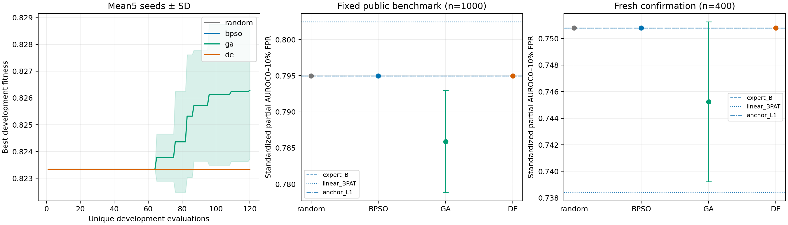

# R11—R13：统一基准、低误报特征选择与GA／DE验证

2026-10-29完成。48个登记方案以`3f8b721`提交冻结后，才计算统一基准及400条独立确认样本的指标。20次搜索每次120个不同掩码，服务器和Windows均完成336项候选／测试条件复核。附[全部结果](all-results.md)、[CSV](all-results.csv)、[逐输入分数](heldout-scores.jsonl)、[复核](verification.json)、[搜索记录](search.json)和[具体特征组](selected-groups.json)。

**结论：本次GA在开发集找到了更好的少量附加特征，但该收益没有泛化到统一主测试或新确认集；DE、PSO和随机搜索均返回不添加额外特征的末位方案。L1也只保留末位分数。因此本轮没有得到可以推荐替换强末位基线的新方案。这是对具体编码、适应度、数据与预算的结论，不是对群体优化算法类别的否定。**

图中搜索曲线为五种子的平均最优开发适应度；右两图误差棒为种子间标准差，不是测试置信区间。随机、PSO、DE返回相同末位方案，其曲线／点重叠。正式配对区间见JSON和下表。

## 本轮分别改了什么

- **R11：强基线锚定＋低误报目标。** 始终提供强末位专家B的一个分数，再从259组、19270个额外坐标中挑选。训练元分类器的B分数来自已有五折训练外预测，部署用完整1600条训练的B；B系数可学习，并非固定为1。额外特征和训练质心／标准化沿用已封存高维训练管线。检测头固定L2逻辑回归C=.01、balanced、liblinear，基础模型不训练。
- **R12：遗传算法GA。** 种群12，三元锦标赛，.9概率均匀交叉，每位1/d变异，精英保留。
- **R13：差分进化DE。** 连续潜变量[0,1]上的DE/rand/1/bin，F=.5、CR=.9、边界裁剪，固定>=.5映射到特征掩码。明确是本实验对特征选择的适配，不称标准二进制DE复现。

搜索目标为：**开发集标准化pAUC（误报0—10%区间）−.01×额外坐标保留比例**。pAUC越高，表示整体更关注低误报区域，但不等于在某个固定报警阈值上必然提高召回。没有根据最终测试改目标、参数、阈值或候选。

随机、PSO、GA、DE都跑种子0—4，同一种子使用完全相同的12个初始掩码（含零附加、全部附加及混合密度样本），每次恰好120个不同掩码；重复组合缓存，不额外收费。共2400次按运行计费的唯一组合评估，跨运行共享后实际拟合2181个不同L2掩码，另有一个L1对照。缓存只节约执行，不增加任何方法预算。48个登记方案含重复返回同一末位模型的结果，不能当作48个独立预测器。

搜索总用时1401.05秒（23.35分钟），四个并行拟合、底层BLAS单线程。逐方法时间是共享缓存下的增量耗时，不是独立冷启动竞速。选择更少输入不代表当前提取器已经加速：实现仍计算／读取全缓存再切片，底座仍完整前向。

GA操作依据[二进制变量作者文档](https://pymoo.org/customization/binary.html)和[交叉算子文档](https://pymoo.org/operators/crossover.html)；DE依据[Storn与Price原文](https://groups.csail.mit.edu/EVO-DesignOpt/pb/uploads/Site/differentialEv.pdf)。使用最小numpy实现，没有安装pymoo，也没有声称复现某篇特定特征选择论文。

## 统一比较基准与独立确认分开报告

[固定基准v1](../../configs/benchmarks/v1.json)使用既有融合清单：Aegis前瞻主测试1000、官方测试补充120、ToxicChat前瞻毒性辅助400、官方补充40；Aegis安全400和ToxicChat非毒性400分别决定全局／来源阈值。所有新旧方案使用同一输入和阈值规则；该基准已经被历史实验观察，不能冒充新最终留出。

另从此前未使用的Aegis官方训练分区选取**400条确认输入，正常／危险各200**，排除11722个旧输入ID及精确／近重复。它独立于训练、开发、校准和公共比较集；属于同来源前瞻留出，不是官方测试或新来源证据。附加64条旧训练探针仅做特征一致性检查。确认清单、原始记录哈希和代码在评分前锁定，确认指标没有用于选择方法。

464条特征提取59.91秒，缓存673576832字节（约0.63GiB）；模型／tokenizer／缓存实际字节核验通过。64条探针的P/X/S/A/M/F/L/Q最大差均为0，八条作者F一致性检查误差为0。

本次固定基准上，八个既有冻结头的2760条输入分数与上一轮逐项一致，检查22080个值，最大差为0，见[旧分数一致性记录](legacy-score-identity.json)。这确认本次是把新方法放进同一考场，没有换题后比较分数。

## 主要结果

### 固定Aegis主比较集：1000条

|方案|AUROC|低误报pAUC(.1)|召回|误报|
|---|---:|---:|---:|---:|
|原固定F积分|0.74658|0.62147|30.2%|5.4%|
|监督F32|0.82253|0.69524|49.6%|6.2%|
|F/C64|0.88408|0.74947|54.6%|4.8%|
|完整末位B|0.91576|0.79499|65.6%|4.6%|
|旧多位置完整向量|0.91663|0.79173|67.8%|6.0%|
|旧全部高维信息线性头|0.89190|0.74707|55.8%|5.6%|
|旧分组PSO线性头，五种子均值|0.89311|0.74610|54.88%|4.92%|
|旧四专家加性融合|0.91920|0.80246|64.6%|4.2%|
|本轮锚定全部额外特征|0.89198|0.74722|56.2%|5.6%|
|本轮锚定L1|0.91576|0.79499|65.6%|4.6%|
|本轮随机／PSO／DE，各自五种子均值|0.91576|0.79499|65.6%|4.6%|
|本轮GA，五种子均值|0.91232|0.78590|66.52%|5.56%|
|开发集预选GA种子4|0.90754|0.77806|67.8%|7.2%|

GA平均pAUC相对匹配随机／PSO差为**−0.00909**，条件配对95%区间**[−0.01595,−0.00156]**；仅1／5个种子点值为正。GA平均召回略高，但误报也高，排序指标更差，不能写成有效改进。

原积分没有同样1600条监督训练预算；完整向量与F/C还同时改变表示和估计器。因此这张统一表支持整体方案比较，不能把全部收益归因于某个单一信号，也不是在原论文设置下直接超越0.868。旧PSO的目标／预算与本轮不同，只是历史方案对照；公平算法结论来自本轮匹配的四个方法。

### 新独立确认集：400条

|方案|AUROC|低误报pAUC(.1)|召回|误报|
|---|---:|---:|---:|---:|
|F/C64|0.86350|0.69816|57.5%|8.0%|
|完整末位B|0.90380|0.75079|69.0%|7.5%|
|旧四专家加性融合|0.90030|0.73842|65.5%|8.0%|
|本轮锚定L1|0.90380|0.75079|69.0%|7.5%|
|本轮随机／PSO／DE，各自五种子均值|0.90380|0.75079|69.0%|7.5%|
|本轮GA，五种子均值|0.90052|0.74524|68.4%|9.2%|
|开发集预选GA种子4|0.89660|0.73500|68.0%|10.5%|

GA五个种子的pAUC点值全部低于B，但平均差−0.00555的条件区间**[−0.01858,+0.00824]**包含零；样本量有限，结论是未确认增益，不是证明GA普遍更差。开发集预选种子4只增加40维，在新确认集却比B少抓2条危险输入、多误报6条正常输入；没有把测试上相对好看的其他种子换成最终方案。

上一轮四专家融合的小幅主测试排序增益，也没有在本次新确认集重复：AUROC相对B差−0.00350，区间[−0.00910,+0.00123]包含零。这更新了证据范围，不据此宣告融合普遍无效。

ToxicChat前瞻毒性辅助任务上，GA平均pAUC为0.76545，B为0.75934，差区间[−0.00658,+0.02159]包含零；来源校准后GA平均召回56.3%、误报4.4%，B为55.5%、4.5%。单个来源上的点值不能抵消主任务和独立确认的未改进结果，两个任务不合并平均。

## GA究竟选了什么

|种子|额外坐标数|选中的特征组（层编号为0基）|
|---|---:|---|
|0|24|层31轨迹＋层18模块统计|
|1|6|长度／缺失标记|
|2|8|层30模块统计|
|3|8|层6模块统计|
|4（开发集预选）|40|层4轨迹＋层31轨迹＋层30模块统计|

模块统计包括attention／MLP输出的范数和方向关系，轨迹组含16项统计；选择粒度是整个组，不是逐神经元。五种子所选组的平均两两Jaccard约0.058，稳定性有限；一次选择长度特征也提示样式捷径风险。选中频率不等于因果重要性。

L1只留下1个非零系数，即B本身，19270个额外坐标全部为零。随机、PSO、DE也没有找到优于其开发适应度的附加组合。GA能提高本次开发适应度，但这种收益未泛化，符合开发集适应过强或信号不稳定的线索；样本分布、表示、正则化和搜索分布等原因尚未逐一隔离，不能断言唯一原因。

特别是，随机提案密度取.05／.1／.25／.5，GA的一位小变异更容易在零附加解附近探索极稀疏组合。即使GA获得收益，也不能排除编码／提案分布更匹配的解释。后续需要稀疏密度匹配随机和逐组简单扫描，不能只用算法名称解释表现。

## 报警线的不确定性

所有点指标使用预先固定的独立安全400条95%阶统计阈值，严格分数大于阈值报警，未按测试调到5%。主区间以固定训练及校准阈值为条件。

另在任何新评分之前声明了1000次安全校准＋测试共同重采样的补充分析，不更改阈值或选择模型，见[校准敏感性](calibration-sensitivity.json)。在新确认集上，B的固定点召回69.0%、误报7.5%；同时考虑校准和测试抽样后，召回区间约[61.0%,79.0%]，误报区间[3.5%,14.5%]。GA五种子平均相对B的召回差区间[−4.60,+2.20]个百分点、误报差[−1.60,+3.30]个百分点，仍无稳定收益证据。这是bootstrap敏感性估计，不是形式化误报保证。

## 验证与下一步

已检查20次搜索各120个不同掩码、相同种子初始化、完整预算、最优轨迹单调、预先选择的候选及文件／代码哈希。3160条校准／测试／确认分数、48候选×七种条件的336项点指标、阈值与分组／角色均复核通过。向量化bootstrap包括分数相同情况的测试与sklearn一致，且服务器和Windows都用独立sklearn逐次重建B的五个测试分组1000次bootstrap区间。八个旧头的22080个分数完全复现。没有新增攻击、底座训练、付费API或配额重置。

审查发现的独立探针导入路径、探针成功门槛，以及实际早期运行暴露的259位缓存文件名过长，均先以失败测试复现再修复。最早运行只到保存初始候选便停止；正式20次搜索保持原目标与预算。搜索完成后的中断通过接续提交固定候选后评分解决，未借机重选或重训。

本轮应继续保留B作为默认方案。更值得下一轮验证的是：**用严格分组／嵌套交叉验证和选择稳定性作为适应度，并加入与稀疏程度匹配的随机／简单逐组对照**；每折内重做有监督变换与检测头，防止验证折标签进入拟合。先确认“开发集判好的解能泛化”，再考虑增加算法种类或预算。

限制：五种子、种群12、120唯一组合只是有限pilot；对GA／DE具体变体成立，不能排除其他群体方法。多重比较未校正，方法均值区间以这五个固定优化结果、训练和校准为条件，不覆盖未来重训／新种子的全部变化。独立确认只有同源400条，不是新来源或官方测试；整个实验是文本输入检测，不是完整多模态复现或攻击成功率。当前确认集评分后已成为历史结果，下一轮不能继续称其未见，但统一比较基准v1保持固定。
